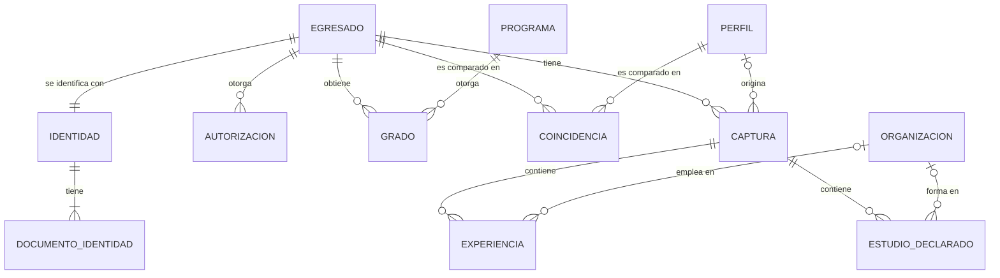
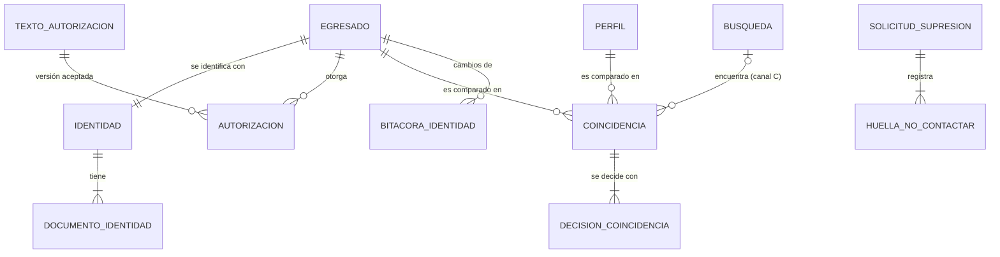
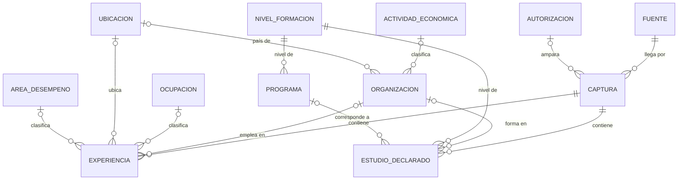
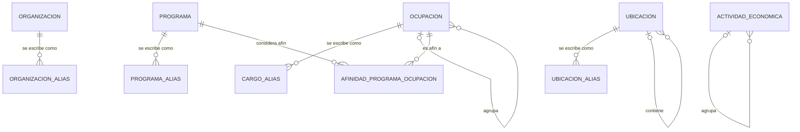
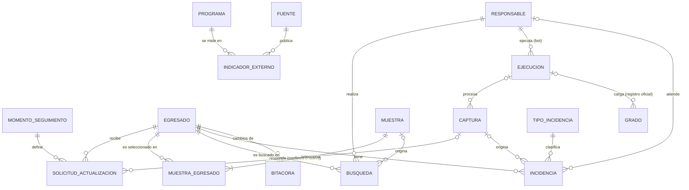

# Modelo de datos

> **Estado:** versión de entrega (noviembre de 2026). El modelo se define en orden, y cada paso se cierra antes de pasar al siguiente:
> 0. Configuración del entorno
> 1. Modelo conceptual: entidades y relaciones, sin tipos
> 2. Modelo lógico: atributos, llaves y normalización
> 3. Modelo físico: tipos de MariaDB, restricciones, índices y permisos
>
> Solo al final se escribe el SQL de creación. El diccionario de datos completo está en [`03_diccionario_datos.md`](03_diccionario_datos.md).

## Paso 0. Configuración del entorno

### 0.1 Servidor

| Parámetro | Valor | Comprobado en el servidor |
|---|---|---|
| Versión | MariaDB 12.3.3 (LTS, soporte hasta 2029) | `SELECT VERSION()` → `12.3.3-MariaDB` |
| Motor por defecto | InnoDB | `@@default_storage_engine` → `InnoDB` |
| Juego de caracteres del servidor | `utf8mb4` | `@@character_set_server` → `utf8mb4` |
| Modo SQL | Estricto | `@@sql_mode` → `STRICT_TRANS_TABLES, ERROR_FOR_DIVISION_BY_ZERO, NO_AUTO_CREATE_USER, NO_ENGINE_SUBSTITUTION` |

Los valores por defecto de la versión 12.3 ya son los que necesitamos. Igual se declaran explícitamente en cada `CREATE DATABASE` y `CREATE TABLE`, para que el resultado no dependa de la configuración del servidor donde se instale.

### 0.2 Decisiones

**Motor: InnoDB**, en vez de MyISAM o Aria.
- Soporta **llaves foráneas**: la integridad entre tablas la garantiza la base, no el código, y el borrado en cascada atiende la revocatoria en una sola operación.
- Soporta **transacciones**: si el bot 1 falla a mitad de una carga, se deshace todo y no queda una captura a medias.
- `NO_ENGINE_SUBSTITUTION` (activo) hace que, si InnoDB no estuviera disponible, la creación de la tabla falle con un error en lugar de usar otro motor en silencio.

**Juego de caracteres: `utf8mb4`**, en vez de `utf8mb3` o `latin1`.
- `utf8mb4` representa todo Unicode. `latin1` no tiene muchos caracteres que pueden aparecer en nombres de personas, empresas o ciudades del exterior, y `utf8mb3` no cubre todo Unicode. Con ellos el dato se dañaría en silencio.

**Intercalación: `utf8mb4_uca1400_spanish_ai_ci`**, en vez de la neutra `utf8mb4_uca1400_ai_ci` que trae el servidor.
- `ai` (*accent insensitive*) y `ci` (*case insensitive*): "Ingenieria", "Ingeniería" e "INGENIERÍA" se comparan como iguales. Así una restricción `UNIQUE` en un catálogo impide registrar el mismo valor dos veces escrito distinto.
- **Variante en español:** la neutra, al ignorar las tildes, trata la ñ como n. La española la trata como una letra propia. Prueba en el servidor:

  | Comparación | Neutra | Española |
  |---|---|---|
  | `'Peña' = 'Pena'` | 1 (iguales) ✗ | 0 (distintas) ✓ |
  | `'José' = 'Jose'` | — | 1 (iguales) ✓ |

- **`spanish` y no `spanish2`:** `spanish2` es el orden tradicional, que trata "ch" y "ll" como letras aparte. La RAE las considera dígrafos desde 1994, así que se usa el orden moderno.
- **`PAD SPACE` y no `NOPAD`:** con `PAD SPACE` se ignoran los espacios al final al comparar, de modo que "Bogotá" y "Bogotá " no pasan como valores distintos. Los bots igual limpian los espacios antes de guardar.
- **Alcance:** la intercalación gobierna las comparaciones, el orden y las restricciones `UNIQUE` dentro de la base. La comparación de nombres del puntaje de confianza la hace el motor de cruce con sus propias reglas de normalización.

**Modo estricto**, en vez del modo permisivo.
- En modo permisivo, MariaDB recorta un texto que no cabe o ajusta una fecha inválida y lo guarda con una advertencia que nadie lee. En modo estricto rechaza la operación con un error, y el bot la registra como incidencia de calidad.

### 0.3 Bases de datos

| Base | Contenido | Quién accede |
|---|---|---|
| `egresados_identidad` | Nombres, documentos, correos, perfiles de LinkedIn, coincidencias con los datos observados de cada candidato, autorizaciones, supresiones, lista de no contactar y su propia bitácora | Bots (para el cruce), revisor y responsable de titulares |
| `egresados` | Grados, capturas, experiencias, estudios declarados, catálogos, seguimiento, muestras, incidencias y bitácora; cada persona se identifica con un ID interno | Todos los roles; el analista solo lee |

La justificación está en la decisión 15 del registro de decisiones de la metodología.

### 0.4 Roles y usuarios

| Rol | Permisos | Asignado a |
|---|---|---|
| `rol_admin` | Crear y modificar la estructura de las dos bases | Administrador de la base |
| `rol_bot` | Leer la identidad para el cruce; insertar capturas, experiencias, estudios e incidencias | Usuarios de los bots 1 y 2 |
| `rol_revisor` | Leer las dos bases; registrar capturas manuales (canal C); resolver incidencias y coincidencias | Auxiliar |
| `rol_titulares` | Atender revocatorias: borrar a la persona y registrar la constancia | Responsable de protección de datos |
| `rol_analista` | Solo lectura sobre `egresados`; ningún permiso sobre `egresados_identidad` | Quien calcula los indicadores |

- **Roles, en vez de permisos por usuario:** los permisos se definen una sola vez por función. Si cambia el auxiliar, a la persona nueva se le asigna `rol_revisor` y a la anterior se le retira, sin copiar permisos a mano.
- **Un usuario por persona y por bot; nadie trabaja como `root`:** así la bitácora registra quién hizo cada cambio. Con un usuario compartido no se puede saber.
- **Mínimo privilegio:** cada rol tiene solo los permisos que su función necesita. Los permisos exactos por tabla se fijan en el paso 3, cuando existan las tablas.

### 0.5 Convenciones de nombres

| Regla | Ejemplo | Por qué |
|---|---|---|
| Minúsculas, guion bajo, español sin tildes | `estudio_declarado` | Las tildes y las mayúsculas en nombres de objetos dan problemas con algunas herramientas y entre sistemas operativos |
| Tablas en singular | `egresado` | Cada fila representa un egresado |
| Llave primaria `id_<tabla>` si es un número sin significado; `codigo_<tabla>` si es un código con significado (oficial o propio). La llave foránea conserva el mismo nombre | `captura.id_egresado` → `egresado.id_egresado`; `experiencia.codigo_ocupacion` → `cat_ocupacion.codigo_ocupacion` | Se ve a simple vista qué se une con qué, y si la llave es un número interno o un código con significado |
| Si una tabla tiene dos llaves foráneas hacia la misma tabla, se agrega el papel de cada una | `id_responsable_apertura`, `id_responsable_asignado` | Distingue para qué sirve cada una |
| Catálogos con prefijo `cat_` | `cat_programa`, `cat_ocupacion` | Distingue los datos de referencia de los datos de las personas |
| Booleanos con prefijo `es_` o `tiene_` | `es_actual` | El nombre dice qué significa el valor verdadero |
| Fechas con prefijo `fecha_`; años con `anio_` | `fecha_hora_captura`, `anio_inicio` | Se sabe el tipo y la precisión sin abrir el diccionario |

## Paso 1. Modelo conceptual

Qué existe y cómo se relaciona, sin tipos de datos ni columnas definitivas. El modelo tiene **39 entidades**: 10 en `egresados_identidad` y 29 en `egresados`. Casi todas repiten uno de siete patrones, así que entendiendo los patrones se entiende el modelo.

### 1.1 Los siete patrones

| # | Patrón | Idea | Entidades | Requisito del enunciado |
|---|---|---|---|---|
| 1 | Persona → grado → captura → contenido | El egresado tiene grados oficiales y capturas de su perfil; cada captura contiene experiencias y estudios | EGRESADO, GRADO, CAPTURA, EXPERIENCIA, ESTUDIO_DECLARADO | 3.2.3 Identificación de registros |
| 2 | Identificar una vez, capturar muchas | Que un perfil es de un egresado se decide una sola vez; las capturas se repiten en cada momento de seguimiento | PERFIL, COINCIDENCIA, DECISION_COINCIDENCIA | 3.1 Identificación de egresados |
| 3 | Catálogo + diccionario de equivalencias | Cada catálogo tiene un diccionario que traduce cómo escribe la gente a un código oficial; el diccionario crece con cada validación | PROGRAMA, ORGANIZACION, OCUPACION y UBICACION, con sus diccionarios PROGRAMA_ALIAS, ORGANIZACION_ALIAS, CARGO_ALIAS y UBICACION_ALIAS | 3.2.4 Estandarización |
| 4 | Catálogo jerárquico | Una sola entidad por clasificación; cada código apunta a su nivel superior | OCUPACION, ACTIVIDAD_ECONOMICA, UBICACION | 3.2.4 Estandarización |
| 5 | Trazabilidad | Todo dato sabe de dónde vino, qué proceso lo produjo, con qué versión y quién lo decidió | FUENTE, EJECUCION, RESPONSABLE, DECISION_COINCIDENCIA, BITACORA, BITACORA_IDENTIDAD | 3.2.5 Control de calidad |
| 6 | Consentimiento y supresión | Qué autorizó cada quien, con qué texto, y qué queda cuando revoca | TEXTO_AUTORIZACION, AUTORIZACION, SOLICITUD_SUPRESION, HUELLA_NO_CONTACTAR | 3.1 Protección de datos |
| 7 | Seguimiento medible | También se registra lo que se pidió, lo que se buscó y lo que no se encontró | MOMENTO_SEGUIMIENTO, SOLICITUD_ACTUALIZACION, MUESTRA, MUESTRA_EGRESADO, BUSQUEDA, INDICADOR_EXTERNO | 3.1 Implementación y análisis |

### 1.2 Base `egresados_identidad` (10 entidades)

| Entidad | Qué representa | Por qué existe, y en vez de qué |
|---|---|---|
| **IDENTIDAD** | Nombres y apellidos (por separado) y correos de contacto | Relación 1 a 1 con EGRESADO, en otra base por seudonimización. Nombres y apellidos van separados porque el cruce admite uno o dos apellidos |
| **DOCUMENTO_IDENTIDAD** | Tipo y número de cada documento de la persona | Muchos estudiantes ingresan con tarjeta de identidad y se gradúan con cédula, y hay extranjeros con pasaporte. Con un solo campo en IDENTIDAD se perdería el documento anterior y fallaría el cruce con registros viejos |
| **TEXTO_AUTORIZACION** | Cada versión del texto de autorización, con sus finalidades | Permite probar qué texto aceptó cada quien sin copiar el texto completo en cada autorización |
| **AUTORIZACION** | Que un egresado aceptó una versión del texto: fecha, canal y evidencia | El Decreto 1377 (art. 8) exige conservar prueba de la autorización. Es una entidad y no un campo "sí/no", porque hay renovaciones y versiones nuevas del texto |
| **PERFIL** | Un perfil de LinkedIn: URL vigente y su huella HMAC | Va separado del egresado porque en el canal C hay perfiles candidatos que todavía no se sabe de quién son. La huella permite reconocer un perfil ya descartado aunque su URL se haya borrado |
| **COINCIDENCIA** | Comparación entre un egresado y un perfil: datos observados del candidato, puntaje total y de cada componente, nivel y estado | Es una relación muchos a muchos con datos propios. Guarda cada componente por separado para poder recalibrar los pesos con casos reales. Los datos observados se borran al cerrar la decisión (conservación limitada); quedan los puntajes |
| **DECISION_COINCIDENCIA** | Cada decisión sobre una coincidencia: automática, de revisión humana o de auditoría | Si la decisión fuera un solo campo, la revisión humana borraría la decisión del bot y no se podría medir cuántas veces se equivoca el nivel alto, que es lo que exige la calibración (metodología, 1.4) |
| **SOLICITUD_SUPRESION** | Constancia de una revocatoria: fecha de solicitud, fecha de atención y canal | **No tiene llave foránea hacia la persona, a propósito:** debe sobrevivir al borrado. Con llave, el borrado en cascada la eliminaría |
| **HUELLA_NO_CONTACTAR** | Huellas HMAC de los documentos, URL y correos de quien revocó | Es una entidad hija y no un campo porque una persona puede tener varios documentos y perfiles. Con una sola huella, el canal C podría volver a incluirla por otro de ellos |
| **BITACORA_IDENTIDAD** | Cambios en las tablas de identidad: valor anterior, valor nuevo, quién y cuándo | Va en esta base y no en la bitácora general: como guarda valores, en `egresados` sería una puerta trasera a la identidad |

### 1.3 Base `egresados`: formación oficial (6 entidades)

| Entidad | Qué representa | Por qué existe, y en vez de qué |
|---|---|---|
| **EGRESADO** | La persona: un ID interno sin significado y el sexo registrado en el sistema académico | Es el centro del modelo. Casi no tiene datos propios porque todo lo demás cuelga de ella. El sexo sirve para analizar brechas de género (metodología, sección 2) |
| **GRADO** | Egresado + programa + periodo de ingreso + fecha de grado + estado (en trámite u otorgado) | Va separado de EGRESADO porque una persona puede tener varios títulos. El estado "en trámite" es la lista de espera: quien se inscribe a grado entra al sistema antes de graduarse |
| **PROGRAMA** | Programa de la Facultad: nivel, código SNIES, duración mínima y si sigue vigente | La duración mínima (regla de casos imposibles) es un dato y no una constante en el código. Los programas sin admisión siguen en el catálogo porque tienen egresados |
| **PROGRAMA_ALIAS** | Formas en que la gente escribe el programa | Patrón 3. El caso real es el PDF de prueba: "Ingenieria en sistemas y computación" frente al nombre oficial |
| **AFINIDAD_PROGRAMA_OCUPACION** | Qué ocupaciones (CUOC) se consideran pertinentes para cada programa | Responde "¿trabaja en su área?" con una regla explícita que define cada comité de programa, en vez de que la IA lo decida caso por caso |
| **NIVEL_FORMACION** | Pregrado, especialización, maestría, doctorado, técnico o tecnológico, otro, no determinado; con un orden | Lo usan PROGRAMA y ESTUDIO_DECLARADO. Un solo catálogo evita que "maestría" se escriba distinto en cada uno, y el orden permite preguntar si alguien estudió un nivel superior al de su grado |

### 1.4 Base `egresados`: capturas y contenido (5 entidades)

| Entidad | Qué representa | Por qué existe, y en vez de qué |
|---|---|---|
| **CAPTURA** | Una foto del perfil: fecha, fuente, perfil, autorización que la ampara, quién la registró, estado, situación laboral declarada, huella SHA-256 del PDF y fecha en que se borró el archivo | Es la base del historial (decisión 14 de la metodología). La huella detecta el mismo PDF subido dos veces y prueba qué archivo se procesó, aun después de borrarlo. Aquí basta un SHA-256 simple porque un PDF no se puede adivinar, a diferencia de un número de documento |
| **EXPERIENCIA** | Un cargo dentro de una captura: cargo como lo escribió la persona, año y mes de inicio y fin, si es actual, tipo de vínculo y cuatro clasificaciones (organización, ocupación, ubicación y área), cada una con su valor propuesto, método, confianza y valor final | Pertenece a la captura y no al egresado, así el historial queda completo. El valor propuesto y el final van en la misma fila, y no en una entidad aparte, porque cada experiencia tiene exactamente una propuesta y un valor final por clasificación; con los dos se mide la precisión de la IA. El tipo de vínculo (empleo, práctica, independiente, voluntariado) evita que una práctica cuente como primer empleo |
| **ESTUDIO_DECLARADO** | Un estudio del PDF: institución, nivel, programa como lo escribió la persona, años; y el programa de la Facultad si corresponde | Va separado de GRADO porque lo declarado no es oficial (decisión 1 de la metodología). El enlace opcional a PROGRAMA es el que usa el cruce |
| **ORGANIZACION** | Empresa o institución, normalizada: nombre, país, NIT si es colombiana, y su actividad económica (CIIU) con su valor propuesto y final | Una sola entidad para empresas e instituciones: la UNAL es a la vez donde estudiaron y donde muchos trabajan, y con dos catálogos quedaría registrada dos veces. La actividad va aquí y no en cada experiencia, para que la misma empresa no termine en tres sectores distintos. El NIT permite tomar la actividad que la empresa tiene registrada en lugar de inferirla |
| **ORGANIZACION_ALIAS** | "Bancolombia S.A.", "Grupo Bancolombia"… → una sola organización | Patrón 3 |

### 1.5 Base `egresados`: catálogos de estandarización (8 entidades)

| Entidad | Qué representa | Por qué existe, y en vez de qué |
|---|---|---|
| **OCUPACION** | Ocupaciones según la CUOC (DANE, actualización 2025), con su jerarquía de cinco niveles | Patrón 4: una sola entidad en la que cada código apunta a su nivel superior, en vez de una entidad por nivel. Así se puede agregar por gran grupo o por ocupación con la misma tabla. La CUOC es el referente oficial para las ocupaciones del mercado laboral colombiano y se construye sobre la CIUO-08 (decisión 36 de la metodología) |
| **CARGO_ALIAS** | Cargo escrito → código de ocupación validado | Es el "catálogo de cargos" que pide el enunciado. Primero se busca aquí y la IA solo se usa para cargos nuevos: el mismo cargo recibe siempre el mismo código, y la carga de IA y de revisión baja con el tiempo |
| **ACTIVIDAD_ECONOMICA** | Actividades económicas según la CIIU Rev. 4 A.C. (DANE, 2022), con su jerarquía; su primer nivel (sección) es el sector | Patrón 4 |
| **UBICACION** | País → departamento → municipio (ISO 3166-1 y DIVIPOLA) | Una sola jerarquía para Colombia y el exterior: "Bogotá / otra ciudad / exterior" sale de una sola consulta |
| **UBICACION_ALIAS** | "Bogotá, Distrito Capital, Colombia", "Área metropolitana de Bogotá"… → un código | Patrón 3. LinkedIn escribe la misma ciudad de varias formas |
| **AREA_DESEMPENO** | Áreas funcionales: docencia, investigación, desarrollo, consultoría, gestión, operación, emprendimiento, otra | El enunciado pide un catálogo de áreas de desempeño. Complementa a la ocupación: la ocupación dice qué es el cargo; el área dice a qué se dedica la persona dentro de la organización |
| **FUENTE** | Origen del dato: PDF en el grado (A), PDF en actualización (B), consulta manual (C), formulario directo, registro académico, encuesta, Observatorio Laboral; cada una con su base legal | La base legal es un atributo de la fuente y no una entidad aparte, porque depende solo de la fuente |
| **TIPO_INCIDENCIA** | Tipos de problema de calidad, con su dimensión (Ley 1581, art. 4 lit. d), su severidad y si bloquea la captura | Es un catálogo y no texto libre, para poder contar incidencias por tipo y por dimensión de calidad |

Los catálogos se nombran por el concepto (ocupación, actividad económica) y no por la clasificación (CUOC, CIIU), para que una actualización del DANE cambie el contenido y no el modelo (paso 2).

### 1.6 Base `egresados`: seguimiento y cobertura (6 entidades)

| Entidad | Qué representa | Por qué existe, y en vez de qué |
|---|---|---|
| **MOMENTO_SEGUIMIENTO** | M0, M1, M3, M5, M10…: años después del grado | La política de seguimiento queda como dato: si la Facultad agrega un M2, no se cambia el código |
| **SOLICITUD_ACTUALIZACION** | Cada solicitud enviada: momento, fecha, enlace personal (huella del código y vencimiento) y respuesta | Mide el cansancio del egresado: la tasa de respuesta por momento. El "sigo igual" se registra aquí como respuesta y apunta a la captura que confirma; si el egresado sube un PDF, apunta a la captura nueva. Del código del enlace solo se guarda la huella, para que una copia de la base no permita usar los enlaces |
| **MUESTRA** | Diseño de una muestra del canal C: población, margen de error, nivel de confianza y semilla aleatoria | Reproducibilidad: con la semilla se obtiene otra vez la misma selección. El enunciado pide un proceso reproducible |
| **MUESTRA_EGRESADO** | Egresados seleccionados en una muestra, con su estrato y su peso | El peso (egresados del estrato ÷ seleccionados) es lo que convierte los resultados de la muestra en estimaciones de toda la cohorte. Sin guardarlo no se puede estimar |
| **BUSQUEDA** | Cada búsqueda manual de un egresado: fecha, responsable, versión del protocolo y resultado (encontrado, varios candidatos, no encontrado) | Distingue "no se buscó" de "se buscó y no se encontró". Lo segundo es información: la tasa de no encontrados por estrato mide el sesgo de la muestra |
| **INDICADOR_EXTERNO** | Indicadores agregados que publican fuentes oficiales por programa y año (por ejemplo, el Observatorio Laboral) | Permite contrastar lo que se mide con LinkedIn contra cifras oficiales y estimar su sesgo |

### 1.7 Base `egresados`: proceso y calidad (4 entidades)

| Entidad | Qué representa | Por qué existe, y en vez de qué |
|---|---|---|
| **RESPONSABLE** | Persona del equipo o bot: usuario de MariaDB, nombre, tipo y fechas de alta y baja | "Quién" siempre es un responsable, sea persona o bot. La bitácora toma el usuario de la sesión de MariaDB, que la aplicación no puede falsear, y esta entidad lo traduce a un nombre. Los roles no se repiten aquí: ya los sabe MariaDB (paso 0), y guardarlos dos veces permitiría que se contradigan |
| **EJECUCION** | Cada corrida de un proceso automático: tipo (carga oficial, carga de catálogos, bot 1, bot 2, clasificación, envío de solicitudes, muestreo, depuración), versión, modelo de IA y parámetros (pesos, umbrales y versiones de las clasificaciones), inicio y fin | Toda decisión automática apunta a la ejecución que la tomó y a los parámetros que estaban vigentes. Si se corrige un error del algoritmo, se sabe exactamente qué registros revisar |
| **INCIDENCIA** | Un problema de calidad: tipo, egresado, captura (si aplica), campo afectado, estado y responsable asignado | Es el registro de faltantes y problemas que pide el enunciado (3.2.5). Su descripción no lleva valores de identidad |
| **BITACORA** | Cambios en las tablas de `egresados`: tabla, registro, valores anteriores y nuevos, usuario y fecha | Da la trazabilidad de cada corrección. Lleva el ID del egresado para poder borrar también su rastro si revoca |

### 1.8 Reglas del modelo

1. **Una persona, un EGRESADO**, aunque tenga varios documentos, varios grados y varias capturas.
2. **Un perfil se acepta para un solo egresado, y un egresado tiene un solo perfil aceptado.** Si aparece un segundo, la base rechaza la aceptación y el revisor decide cuál es el correcto.
3. **Se identifica una vez y se captura muchas veces.** En las capturas siguientes del mismo perfil solo se comprueba que la URL del PDF sea la del perfil aceptado.
4. **Una captura con perfil solo se asocia a un egresado si existe una coincidencia aceptada** entre los dos. La excepción es la fuente "formulario directo", que no tiene perfil.
5. **Los estados que se pueden calcular no se guardan:** "vigente", "desactualizado" o "pendiente" salen de las fechas y las decisiones. Un estado guardado puede llegar a contradecir los datos de los que se deriva. **Excepción controlada:** el estado de una coincidencia sí se guarda, porque la regla 2 necesita una restricción `UNIQUE` y esa restricción solo puede apoyarse en columnas guardadas. Lo actualiza un disparador con cada decisión, no la aplicación (paso 2).
6. **Todo dato producido por un proceso automático apunta a su EJECUCION; todo dato producido por una persona, a su RESPONSABLE.**
7. **Las incidencias y la bitácora de `egresados` no contienen valores de identidad** (nombres, documentos, URL).
8. **Conservación limitada:** el PDF se borra cuando su captura queda verificada o rechazada (se conserva la huella). Los datos observados de cada candidato se borran al cerrar su decisión; si se descartó, también su URL (se conserva la huella).
9. **Los catálogos no se borran, se desactivan,** porque los registros históricos los siguen usando. La única excepción es fusionar organizaciones duplicadas: se reasignan todas sus referencias y alias, y luego se borra la duplicada.
10. **La supresión es una sola transacción:** registra la constancia y las huellas, borra los perfiles aceptados de la persona y borra el EGRESADO, que arrastra en cascada todo lo demás de las dos bases. Los perfiles se borran explícitamente porque no dependen de un egresado (pueden ser candidatos). MariaDB admite llaves foráneas entre bases del mismo servidor, con borrado en cascada (paso 3, prueba T1).

### 1.9 Diagramas

**Vista general**

**Identidad y consentimiento** (`egresados_identidad`)

SOLICITUD_SUPRESION no se relaciona con EGRESADO: es intencional (sección 1.2).

**Captura y estandarización**

**Catálogos: diccionarios y jerarquías**

**Seguimiento, cobertura y proceso**

EJECUCION también se relaciona con COINCIDENCIA, DECISION_COINCIDENCIA (decisiones automáticas), EXPERIENCIA y ORGANIZACION (clasificación) y MUESTRA (selección). Se omite en el diagrama para que se pueda leer.

### 1.10 Qué entidades toca cada proceso

| Proceso | Lee | Escribe |
|---|---|---|
| Carga del registro oficial | PROGRAMA | EGRESADO, IDENTIDAD, DOCUMENTO_IDENTIDAD, GRADO, EJECUCION |
| Canal A: inscripción a grado | GRADO, TEXTO_AUTORIZACION, diccionarios | AUTORIZACION, PERFIL, COINCIDENCIA, DECISION_COINCIDENCIA, CAPTURA, EXPERIENCIA, ESTUDIO_DECLARADO, INCIDENCIA |
| Canal B: momento de seguimiento | MOMENTO_SEGUIMIENTO, GRADO, CAPTURA vigente | SOLICITUD_ACTUALIZACION; si hubo cambios, una CAPTURA nueva con su contenido |
| Canal C: consulta manual | MUESTRA_EGRESADO, IDENTIDAD, GRADO, HUELLA_NO_CONTACTAR | BUSQUEDA, PERFIL, COINCIDENCIA, DECISION_COINCIDENCIA; si se acepta, CAPTURA |
| Clasificación | Diccionarios (`_ALIAS`), catálogos | Clasificaciones de EXPERIENCIA, ESTUDIO_DECLARADO y ORGANIZACION; nuevos alias cuando una persona valida |
| Revisión humana | COINCIDENCIA, INCIDENCIA | DECISION_COINCIDENCIA, INCIDENCIA, BITACORA |
| Depuración (conservación limitada) | CAPTURA, COINCIDENCIA | Borra los PDF de capturas cerradas y los datos observados de coincidencias decididas; registra la EJECUCION |
| Supresión (revocatoria) | DOCUMENTO_IDENTIDAD, PERFIL, IDENTIDAD | SOLICITUD_SUPRESION, HUELLA_NO_CONTACTAR; borra PERFIL y EGRESADO (en cascada, todo lo demás) |

### 1.11 Cada pregunta de análisis tiene de dónde salir

| Pregunta (metodología, sección 6) | Entidades |
|---|---|
| Vinculación laboral por momento de seguimiento | GRADO (fecha) + última CAPTURA verificada (situación declarada) + EXPERIENCIA (fechas, tipo de vínculo) |
| Sectores y ocupaciones | EXPERIENCIA → ORGANIZACION → ACTIVIDAD_ECONOMICA; EXPERIENCIA → OCUPACION |
| Tiempo hasta el primer empleo | GRADO (fecha) + primera EXPERIENCIA de tipo empleo o independiente |
| Trabajo en el área de formación | EXPERIENCIA (ocupación) + AFINIDAD_PROGRAMA_OCUPACION del programa del GRADO |
| Movilidad geográfica | EXPERIENCIA → UBICACION (jerarquía) |
| Posgrado | ESTUDIO_DECLARADO (NIVEL_FORMACION, ORGANIZACION) + GRADO en programas de posgrado de la Facultad |
| Evolución de la trayectoria | EXPERIENCIA a lo largo del tiempo (por ejemplo, llegada al gran grupo 1 de la CUOC, "directores y gerentes") |
| Brechas de género | Todas las anteriores, por EGRESADO (sexo) |
| Cobertura y calidad del sistema | CAPTURA, SOLICITUD_ACTUALIZACION, DECISION_COINCIDENCIA, BUSQUEDA, MUESTRA_EGRESADO, INCIDENCIA, INDICADOR_EXTERNO |

### 1.12 Correspondencia con el enunciado (punto 3.2)

| Requisito | Dónde se cumple |
|---|---|
| 3.2.1 Diccionario de datos | [`03_diccionario_datos.md`](03_diccionario_datos.md), con los tipos de MariaDB del paso 3 |
| 3.2.2 Estructura de almacenamiento | Dos bases MariaDB (paso 0) + archivos PDF temporales en una carpeta de acceso restringido, que se borran al cerrar la captura (regla 8) |
| 3.2.3 Llave única y relaciones | Llave: `id_egresado`, interna y sin significado; los documentos son llaves alternas en DOCUMENTO_IDENTIDAD. Relaciones: EGRESADO → GRADO (formación oficial); EGRESADO → CAPTURA → EXPERIENCIA y ESTUDIO_DECLARADO |
| 3.2.4 Estandarización | Programas: PROGRAMA + alias. Sectores: ACTIVIDAD_ECONOMICA (vía ORGANIZACION). Cargos: OCUPACION + CARGO_ALIAS. Áreas: AREA_DESEMPENO. Ubicaciones: UBICACION + alias |
| 3.2.5 Control de calidad | Duplicados: reglas, huellas y restricciones `UNIQUE`. Validación: dominios, restricciones, modo estricto y llaves foráneas. Faltantes: INCIDENCIA de tipo incompleta. Fuentes: FUENTE, EJECUCION, RESPONSABLE, DECISION_COINCIDENCIA y las dos bitácoras |
| 3.2.6 Datos de prueba | [`sql/10_datos_prueba.sql`](../sql/10_datos_prueba.sql): 10 egresados ficticios en 11 casos, cada uno con una parte del diseño en acción (paso 3.12) |

**Por qué una llave interna y no el documento:** el documento cambia (tarjeta de identidad → cédula), es un dato de identidad que no puede estar en la base de análisis, y una persona puede tener más de uno. Una llave interna sin significado no cambia nunca y no revela nada.

### 1.13 Alternativas que se consideraron y se descartaron

| Se descartó | Se eligió | Por qué |
|---|---|---|
| Una entidad VERIFICACION para el "sigo igual" | Registrarlo como respuesta en SOLICITUD_ACTUALIZACION | La confirmación siempre responde a una solicitud. Con dos entidades, el mismo hecho quedaría en dos lugares |
| Una entidad BASE_LEGAL | Atributo de FUENTE | La base legal depende solo de la fuente |
| Una entidad de "codificaciones" | Valor propuesto y final en la misma fila | Cada experiencia tiene exactamente una propuesta y un valor final por clasificación, y así cada columna tiene una llave foránea real hacia su catálogo |
| Una sola tabla genérica de alias para todos los catálogos | Una tabla de alias por catálogo | Una tabla genérica no puede tener una llave foránea real hacia catálogos distintos |
| Una entidad por nivel de cada clasificación | Una entidad por clasificación con referencia al nivel superior | Una sola tabla sirve para agregar por cualquier nivel |
| Catálogos separados de empresas e instituciones | ORGANIZACION | La misma institución puede ser lugar de estudio y de trabajo |
| Un solo campo de documento | DOCUMENTO_IDENTIDAD | Los documentos cambian a lo largo de la vida académica |
| Una sola bitácora | Una por base | La bitácora guarda valores; en la base de análisis filtraría la identidad |
| Guardar el estado del egresado | Calcularlo | Un estado guardado puede contradecir los datos de los que se deriva |
| Guardar el PDF indefinidamente | Borrarlo al cerrar la captura y conservar su huella | El PDF trae datos que se decidió no guardar (correo, aptitudes) |
| Registrar solo las búsquedas exitosas | BUSQUEDA con todos los resultados | "No encontrado" mide el sesgo de la muestra |
| Momentos y tipos de incidencia fijos en el código | Catálogos | La Facultad puede cambiar la política sin tocar el código |

**Criterio para listas cortas:** un catálogo es una tabla cuando tiene atributos propios o puede cambiar por decisión institucional (FUENTE, TIPO_INCIDENCIA, MOMENTO_SEGUIMIENTO). Las listas fijas de valores técnicos, como los estados de una captura o el tipo de vínculo, se validan con una restricción `CHECK` en el paso 3. Una tabla para cada lista fija agregaría uniones sin aportar nada.

## Paso 2. Modelo lógico

Este paso define, para cada entidad, sus atributos, sus llaves, qué es obligatorio, qué significa cada vacío y qué reglas debe cumplir, y comprueba la normalización. **El detalle, tabla por tabla, está en [`03_diccionario_datos.md`](03_diccionario_datos.md).** Aquí van las decisiones que lo rigen. Los tipos exactos de MariaDB se asignan en el paso 3.

### 2.1 De entidades a tablas

Cada entidad es una tabla, con el nombre en minúsculas (paso 0.5). Los catálogos llevan el prefijo `cat_`.

| Base | Tablas |
|---|---|
| `egresados_identidad` (10) | `identidad`, `documento_identidad`, `texto_autorizacion`, `autorizacion`, `perfil`, `coincidencia`, `decision_coincidencia`, `solicitud_supresion`, `huella_no_contactar`, `bitacora_identidad` |
| `egresados` (29) | `egresado`, `grado`, `cat_programa`, `programa_alias`, `afinidad_programa_ocupacion`, `cat_nivel_formacion`, `captura`, `experiencia`, `estudio_declarado`, `cat_organizacion`, `organizacion_alias`, `cat_ocupacion`, `cargo_alias`, `cat_actividad_economica`, `cat_ubicacion`, `ubicacion_alias`, `cat_area_desempeno`, `cat_fuente`, `cat_tipo_incidencia`, `cat_momento_seguimiento`, `solicitud_actualizacion`, `muestra`, `muestra_egresado`, `busqueda`, `indicador_externo`, `responsable`, `ejecucion`, `incidencia`, `bitacora` |

**Los catálogos se nombran por el concepto, no por la clasificación:** `cat_ocupacion` y no `cat_cuoc`; `cat_actividad_economica` y no `cat_ciiu`.
- *Por qué:* el DANE actualiza sus clasificaciones. La CUOC tuvo una actualización en 2025 y la CIIU Rev. 5 está en adaptación. Si cambia la clasificación, cambia el contenido del catálogo, no el modelo. La versión cargada queda registrada en la ejecución que cargó el catálogo.

**Ocupaciones con la CUOC, no con la CIUO-08 A.C.** Al verificar las fuentes se encontró que el referente oficial para las ocupaciones del mercado laboral colombiano es la Clasificación Única de Ocupaciones para Colombia (CUOC), adoptada por el Decreto 654 de 2021 y actualizada en 2025.
- *Por qué:* se construye sobre la CIUO-08, así que en los niveles superiores conserva la comparación internacional, y agrega un quinto nivel (ocupación) que distingue mejor los cargos.

### 2.2 Llaves primarias

| Tipo de tabla | Llave | Ejemplo | Por qué, y en vez de qué |
|---|---|---|---|
| Entidades con identidad propia | Número interno autoincremental, `id_<tabla>` | `egresado.id_egresado` | **En vez de un UUID:** hay un solo servidor que genera los números, así que no hace falta un identificador que se pueda generar en varios sistemas a la vez. Un número ocupa 4 bytes en lugar de 16, y como InnoDB guarda las filas ordenadas por la llave primaria, un número creciente se agrega al final sin reorganizar la tabla |
| Catálogos oficiales | El código oficial, `codigo_<tabla>` | `cat_ubicacion.codigo_ubicacion = '11001'` (Bogotá) | **En vez de un número interno:** el código es estable y estándar, se lee sin unir tablas y permite cruzar directamente con datos del DANE |
| Catálogos propios | Un código corto con significado | `cat_fuente.codigo_fuente = 'CANAL_C'` | **En vez de un número:** `WHERE codigo_fuente = 'CANAL_C'` se entiende; `WHERE id_fuente = 3` no |
| Tablas de relación que ninguna otra referencia | Llave compuesta por sus dos llaves foráneas | `muestra_egresado (id_muestra, id_egresado)` | Un número adicional no aportaría nada: la pareja ya identifica la fila e impide repetirla |
| Programas y organizaciones | Número interno, con los códigos externos como llaves alternas | `cat_programa.codigo_snies` | No hay un código universal: los programas antiguos pueden no tener código SNIES y las organizaciones extranjeras no tienen NIT |

**El número del egresado no revela nada.** La carga inicial inserta a los egresados en orden aleatorio. Si se insertaran en el orden del archivo fuente (alfabético o por documento), el número conservaría ese orden y daría una pista sobre quién es quién.

**Llaves alternas (`UNIQUE`).** Impiden los duplicados que la llave primaria no ve: tipo y número de documento, URL y huella del perfil, par egresado–perfil, huella del PDF, códigos SNIES y SIA del programa, NIT, texto de cada alias y huella del enlace de actualización.

### 2.3 Llaves foráneas y qué pasa al borrar

| Qué se referencia | Al borrar el registro referenciado | Por qué |
|---|---|---|
| La persona (identidad, documentos, grados, capturas y su contenido, solicitudes, búsquedas, incidencias, bitácoras) | Se borra en cascada (`CASCADE`) | La supresión borra al egresado y todo lo suyo cae con él, sin dejar registros huérfanos |
| Catálogos, responsables y ejecuciones | Se impide el borrado (`RESTRICT`) | No se borran (regla 9 del paso 1): un borrado accidental debe fallar, no arrastrar datos |
| Constancias de supresión | Se impide el borrado | Deben conservarse |

**Llaves foráneas compuestas.** Dos columnas que, juntas, deben existir en otra tabla. Son garantías que la base comprueba sola:
- `captura (id_egresado, id_perfil) → coincidencia`: no puede existir una captura de un perfil que no se haya comparado con ese egresado.
- `busqueda (id_muestra, id_egresado) → muestra_egresado`: una búsqueda hecha dentro de una muestra solo puede ser de un egresado seleccionado en ella. Si la búsqueda no es de una muestra, `id_muestra` queda vacío y la regla no se aplica.

**Llaves foráneas entre las dos bases.** Unen la identidad con el egresado (`identidad.id_egresado`), las capturas con sus coincidencias y autorizaciones, y las tablas de identidad con los responsables y las ejecuciones. Funcionan, con borrado en cascada (paso 3, prueba T1).

### 2.4 Obligatoriedad y vacíos

- **Todo atributo es obligatorio, salvo que su vacío tenga un significado documentado.**
- **Cada atributo opcional tiene un solo significado para el vacío,** escrito en el diccionario:

  | Atributo | El vacío significa |
  |---|---|
  | `experiencia.anio_fin` | Empleo actual ("Present") |
  | `estudio_declarado.anio_fin` | No declarado |
  | `identidad.segundo_apellido` | La persona no tiene segundo apellido |
  | `perfil.url` | URL borrada por conservación limitada |
  | `captura.situacion_declarada` | No se preguntó (canal C) |

- **Cuando una categoría desconocida debe poder contarse, se usa un valor explícito del catálogo en lugar del vacío:** `cat_nivel_formacion` tiene `NO_DETERMINADO`.
- **Si falta un dato obligatorio, la fila no entra.** La captura queda `EN_REVISION` con una incidencia de tipo incompleta, y el revisor completa el dato con el PDF, que se conserva hasta cerrar la captura. Así se cumple "nunca entra a la base sin revisar" sin aceptar vacíos ambiguos.
- *Por qué no dejar todo opcional:* el enunciado pide registrar los datos faltantes (3.2.5), y un vacío sin significado no se puede contar como faltante.

### 2.5 Dominios

Un dominio es un tipo de dato lógico con su formato y su regla de validación, que se define una vez y se usa en muchos atributos. Por ejemplo, todas las huellas usan el dominio `HUELLA`: 64 caracteres hexadecimales. El modelo tiene **28 dominios**, en la sección 1 del diccionario.
- *Por qué:* el mismo tipo de dato se valida igual en todas las tablas. Y en el paso 3 basta asignar un tipo de MariaDB a cada dominio, no a cada uno de los cientos de atributos.

### 2.6 El patrón de clasificación

Las cuatro clasificaciones de una experiencia (organización, ocupación, ubicación y área), la institución de un estudio y la actividad económica de una organización usan las mismas cuatro columnas:

| Columna | Contenido |
|---|---|
| `<x>_propuesto` | Valor que propuso el diccionario, la IA o el registro de la empresa |
| `metodo_<x>` | Cómo se obtuvo la propuesta: DICCIONARIO, IA o REGISTRO (actividad de una empresa colombiana tomada por su NIT) |
| `confianza_<x>` | Confianza de la propuesta: 1 si viene del diccionario o del registro |
| `<x>` | Valor final, que es el que usa el análisis |

- Si el valor final es distinto del propuesto, lo corrigió una persona. Si no hay propuesta, lo asignó una persona directamente.
- *Por qué columnas y no una tabla de propuestas:* cada columna puede tener una llave foránea real hacia su catálogo; una tabla genérica de propuestas no podría (el mismo argumento de los diccionarios, paso 1, 1.13). Además, el análisis lee el valor final sin uniones.
- **Una captura no pasa a `VERIFICADA` mientras alguna clasificación con texto original tenga el valor final vacío.** Por eso, en las capturas verificadas, un valor final vacío solo puede significar "no declarado".

### 2.7 Normalización

El modelo está en **tercera forma normal (3FN)**.

| Forma | Qué exige | Cómo se cumple en el modelo |
|---|---|---|
| 1FN | Valores atómicos y sin grupos repetidos | Los documentos están en su propia tabla, no en `documento1` y `documento2`. Cada experiencia es una fila. El año y el semestre de ingreso son dos columnas, no "2019-1", para poder calcular duraciones |
| 2FN | En las tablas de llave compuesta, todo depende de la llave completa | En `afinidad_programa_ocupacion`, el soporte depende del par programa–ocupación. En `muestra_egresado`, el estrato y el peso dependen del par muestra–egresado |
| 3FN | Ningún atributo depende de otro que no sea la llave | La actividad económica está en la organización, no en cada experiencia. El nivel de formación está en el programa, no en el grado. La fecha de cálculo de una coincidencia está en su ejecución. "Activo" sale de la fecha de baja del responsable, y su rol, de MariaDB |

**Columnas calculadas.** No se guardan: se calculan al consultarlas, así que no pueden contradecir a la columna de la que salen.
- `experiencia.es_actual` sale de si `anio_fin` está vacío.
- El nivel de cada código en los catálogos jerárquicos sale del formato del código (por ejemplo, 5 dígitos en la DIVIPOLA es un municipio).

**JSON como excepción a la 1FN.** `ejecucion.parametros` y los valores de las bitácoras se guardan como documentos JSON.
- *Por qué:* su estructura cambia según el proceso o la tabla, siempre se guardan y se leen completos, y nunca se filtra por una parte de ellos. Repartirlos en columnas daría tablas llenas de vacíos.

**Excepciones controladas a la 3FN** (las únicas, y cada una con su garantía):

| Dato guardado | Se podría calcular de | Por qué se guarda | Cómo se evita que se contradiga |
|---|---|---|---|
| `coincidencia.estado` | La última decisión | La regla "un perfil aceptado para un solo egresado" necesita una restricción `UNIQUE`, que solo puede apoyarse en columnas guardadas | Lo escribe un disparador al registrar cada decisión; ningún rol puede modificarlo directamente |
| `coincidencia.puntaje_total` y `nivel` | Los componentes y los pesos de la ejecución | Son el resultado histórico de esa ejecución: recalcularlos con pesos nuevos daría otro valor y se perdería por qué se decidió así | Se escriben una vez y no se modifican |
| `codigo_padre` en `cat_ocupacion` | Es el código sin su último dígito | Mantiene la misma estructura en los tres catálogos jerárquicos. En la CIIU (de división a sección) y en la ubicación (de departamento a país) no se puede calcular | Una restricción comprueba que el padre sea el código sin su último dígito |

### 2.8 Reglas de integridad

Las reglas del diccionario se agrupan según cuántos datos necesitan ver. Eso define con qué se pueden hacer cumplir. El mecanismo final, decidido después de probar qué admite MariaDB 12.3, está en el paso 3.5.

| Regla | Ve | Mecanismo previsto |
|---|---|---|
| Formatos de los dominios (códigos, huellas, URL, correos, años) | Una columna | `CHECK` |
| Coherencia dentro de una fila: fin ≥ inicio, mes solo con año, grado otorgado con fecha, exactamente uno entre ejecución y responsable | Una fila | `CHECK` |
| Fechas frente al año actual (por ejemplo, un empleo no puede empezar en el futuro) | Una fila y la fecha actual | Disparador: MariaDB no admite la fecha actual en un `CHECK` (paso 3, prueba T2) |
| Un par egresado–perfil se compara una sola vez; documentos, huellas y alias no se repiten | Varias filas de una tabla | `UNIQUE` |
| Un perfil aceptado para un solo egresado; una sola versión vigente del texto de autorización | Varias filas de una tabla | `UNIQUE` sobre una columna calculada a partir del estado |
| Captura solo de perfiles comparados con su egresado; búsqueda en una muestra solo de egresados seleccionados | Dos tablas | Llave foránea compuesta |
| La coincidencia de una captura debe estar aceptada; la autorización es obligatoria según la base legal de la fuente; el país de una organización debe ser de nivel país | Dos tablas | Disparador |
| Una captura no pasa a verificada con incidencias bloqueantes abiertas o clasificaciones pendientes | Varias tablas | Disparador |
| La supresión borra todo en una sola transacción y no deja rastro en las bitácoras | Las dos bases | Procedimiento almacenado |
| Todo usuario que escribe está registrado como responsable; los cambios manuales llevan motivo | Bitácora | Llave foránea y `CHECK` |
| Casos imposibles, puntaje y nivel de una coincidencia | Datos del candidato y del registro oficial | Motor de cruce (bot) |
| Borrado de PDF y de datos observados vencidos | Fechas y estados | Proceso de depuración (bot), registrado como ejecución |

### 2.9 Alternativas que se consideraron y se descartaron en este paso

| Se descartó | Se eligió | Por qué |
|---|---|---|
| UUID como llave primaria | Número autoincremental | Un solo servidor genera los números; ocupa menos y se inserta en orden (sección 2.2) |
| Número interno en los catálogos oficiales | El código oficial | Estable, estándar, legible y cruzable con el DANE |
| Nombrar los catálogos por la clasificación (`cat_ciiu`) | Por el concepto (`cat_actividad_economica`) | Una actualización del DANE cambia el contenido, no el modelo |
| CIUO-08 A.C. | CUOC | Es el referente oficial para el mercado laboral colombiano y conserva la comparación internacional (sección 2.1) |
| Guardar el nombre normalizado en la identidad | Normalizar en el motor de cruce | Sería un dato derivado de otras columnas, y el motor ya normaliza |
| Guardar el rol en el responsable | Lo sabe MariaDB | Dos copias del mismo dato se pueden contradecir |
| Un campo "activo" en el responsable | La fecha de baja | "Activo" se calcula: no tener fecha de baja |
| Guardar la ruta del PDF | El archivo se llama como la captura | La ruta se deduce del número de la captura |
| Una fecha de creación en cada tabla | La bitácora registra cada inserción | Solo se guardan las fechas con significado propio (de captura, de grado, de envío) |
| Un "tipo de organización" (empresa, institución) | La actividad económica | La CIIU ya distingue la educación de las demás actividades |
| Una fila de bitácora por cada campo cambiado | Una fila por operación, con los valores en JSON | Cada operación queda completa en un solo registro |
| Dejar opcional todo lo dudoso | Obligatorio por defecto; un solo significado por vacío | Un vacío sin significado no se puede contar como faltante (sección 2.4) |

## Paso 3. Modelo físico

Este paso asigna a cada dominio su tipo de MariaDB y define cómo se hace cumplir cada regla: restricciones, columnas calculadas, disparadores, procedimientos, índices y permisos. **Todo lo que depende del comportamiento de MariaDB se probó antes en el servidor.**

### 3.1 Pruebas del motor

Se hicieron el 29 de octubre de 2026 en MariaDB 12.3.3, en el equipo de desarrollo: 16 pruebas sobre dos bases temporales que se borraron al final. El script se guardará en el repositorio junto con el SQL.

| Prueba | Qué se probó | Resultado | Qué decide |
|---|---|---|---|
| T0 | Zona horaria y usuario de la sesión | Zona del sistema `America/Bogota`; `SESSION_USER()` devuelve `root@localhost` | Hora de Colombia (3.3); la bitácora guarda solo el nombre de usuario (3.6) |
| T1 | Llave foránea entre dos bases, con cascada | Funciona: el hijo se borró con el padre, y un hijo sin padre dio error | La supresión se apoya en la cascada entre las dos bases |
| T2 | `CHECK` con la fecha actual | **No se permite:** "`curdate()` cannot be used in the CHECK clause" | Las reglas frente a la fecha actual van en disparadores (3.5) |
| T3 | `UNIQUE` sobre una columna calculada | Funciona: rechazó la segunda aceptación del mismo perfil | "Un perfil para un solo egresado" se garantiza con una restricción (3.4) |
| T4 | `REGEXP` en una columna que no distingue mayúsculas | Aceptó `canal_c` como si estuviera en mayúsculas; con `(?-i)` o con `ascii_bin`, no | Los identificadores técnicos usan comparación exacta (3.2) |
| T5 | Tipo `JSON` | MariaDB lo guarda como `LONGTEXT` y le agrega solo la validación `json_valid` | Se usa `JSON` sin validación adicional |
| T6 | `BOOLEAN` | Aceptó un 7 | Los booleanos llevan `CHECK (x IN (0, 1))` |
| T7 | `YEAR` | Convirtió 25 en 2025 sin avisar | Los años son `SMALLINT` con `CHECK` |
| T8 | Resta de enteros sin signo | Un resultado negativo dio error; con signo dio −1 | Años y cantidades con signo; solo los ID sin signo |
| T9 | `FLOAT` frente a `DECIMAL` | 0,7 guardado en `FLOAT` no pasó el umbral de 0,7; en `DECIMAL`, sí | Puntajes y confianzas en `DECIMAL` |
| T10 | Disparador de una tabla hija durante un borrado en cascada | No se activó | Lo que se borra en cascada no deja copias en la bitácora (3.6) |
| T11 | Llave foránea compuesta con una columna vacía | Con `id_muestra` vacío no se comprobó; con valor, sí | Confirmada la regla de búsquedas y muestras |
| T12 | `UNIQUE` con la intercalación en español | "Peña" y "Pena" conviven; "José" y "JOSE" no | Confirmada la intercalación del paso 0 en las restricciones |
| T13 | Columna calculada a partir del formato del código | `CO` → país, `11` → departamento, `11001` → municipio | El nivel de los catálogos es una columna calculada |
| T14 | "Exactamente uno de dos" con `CHECK` | Rechazó ninguno y ambos | La autoría de capturas, decisiones e incidencias se valida con `CHECK` |
| T15 | `TIMESTAMP` frente a `DATETIME` al cambiar la zona de la sesión | `TIMESTAMP` mostró 13:00; `DATETIME`, 08:00 | Las fechas con hora son `DATETIME` (3.3) |

### 3.2 Tipos de datos

**Tres familias de texto, según cómo deben compararse:**

| Familia | Ejemplos | Juego de caracteres e intercalación | Por qué |
|---|---|---|---|
| Identificadores técnicos ASCII | Códigos, listas, huellas, URL, documentos, NIT, versiones | `ascii` + `ascii_bin`: comparación exacta, byte a byte | Un código es igual a otro solo si es idéntico. Con la intercalación en español, `canal_c` sería igual a `CANAL_C` y la validación de mayúsculas no funcionaría (T4) |
| Identificadores con otros caracteres | Correos, usuarios de MariaDB | `utf8mb4` + `utf8mb4_bin` | Exactos, pero pueden traer caracteres fuera de ASCII |
| Lenguaje humano | Nombres, cargos, descripciones | `utf8mb4` + `utf8mb4_uca1400_spanish_ai_ci`, la de la base | Se comparan como lo haría una persona (paso 0) |

**Tipo de cada dominio:**

| Dominio | Tipo en MariaDB | Por qué, y en vez de qué |
|---|---|---|
| `ID` | `INT UNSIGNED`, con `AUTO_INCREMENT` en la llave primaria | Hasta 4.294 millones en 4 bytes; `BIGINT` ocuparía 8 y no hace falta. Es el único tipo sin signo, porque los ID nunca se restan |
| `CODIGO`, `COD_OCUPACION`, `COD_ACTIVIDAD`, `COD_UBICACION` | `VARCHAR(30)`, `VARCHAR(5)`, `VARCHAR(4)`, `VARCHAR(5)`, exactos | Longitud variable, porque los códigos de un mismo catálogo tienen distinto largo según el nivel |
| `LISTA` | `VARCHAR(n)` exacto + `CHECK (x IN (...))` | **En vez de `ENUM`:** el `CHECK` es SQL estándar; `ENUM` es propio de MySQL y MariaDB y ordena por la posición del valor, no alfabéticamente |
| `HUELLA` | `CHAR(64)` exacto | Longitud fija y legible. **En vez de `BINARY(32)`**, que ocupa la mitad pero no se puede leer ni copiar en una consulta |
| `URL_PERFIL` | `VARCHAR(128)` exacto | 28 caracteres de `https://www.linkedin.com/in/` más 100 del identificador |
| `NUM_DOCUMENTO`, `NIT` | `VARCHAR(20)`, `VARCHAR(10)`, exactos | Son identificadores, no cantidades: no se suman y pueden tener letras o ceros a la izquierda |
| `VERSION` | `VARCHAR(20)` exacto | |
| `CORREO` | `VARCHAR(254)` en `utf8mb4_bin` | 254 es el largo máximo de un correo |
| `USUARIO_BD` | `VARCHAR(128)` en `utf8mb4_bin` | Solo el nombre de usuario, sin el equipo (T0) |
| `TEXTO`, `TEXTO_NORMALIZADO` | `VARCHAR(300)` en español | |
| `DESCRIPCION` | `VARCHAR(1000)` en español | |
| `TEXTO_LARGO` | `TEXT` en español | `TEXT` guarda hasta 65 535 bytes: 20 000 caracteres en español caben aunque cada uno ocupe 3 bytes |
| `ANIO` | `SMALLINT` con signo | **En vez de `YEAR`**, que convierte 25 en 2025 sin avisar (T7). **Con signo**, porque restar años sin signo que den negativo produce un error (T8), y los años se restan mucho, por ejemplo en "tiempo hasta el primer empleo" |
| `MES`, `SEMESTRE` | `TINYINT` | |
| `ENTERO` | `INT` con signo | Por la misma razón de las restas |
| `FECHA` | `DATE` | |
| `FECHA_HORA` | `DATETIME` | **En vez de `TIMESTAMP`**, que cambia lo que muestra según la zona de la sesión (T15) |
| `BOOLEANO` | `TINYINT` | El `BOOLEAN` de MariaDB es un `TINYINT` y acepta un 7 (T6); el `CHECK` lo limita a 0 y 1 |
| `PROPORCION` | `DECIMAL(4,3)` | **En vez de `FLOAT`**, que guarda 0,7 como 0,6999… y haría fallar un umbral de 0,7 (T9) |
| `PESO` | `DECIMAL(12,4)` | |
| `DECIMAL` | `DECIMAL(18,4)` | |
| `JSON` | `JSON` | MariaDB lo guarda como `LONGTEXT` y agrega solo la validación (T5) |

Las validaciones físicas de cada dominio (`CHECK`) están en la sección 1 del diccionario. Una llave foránea tiene exactamente el mismo tipo, juego de caracteres e intercalación que la columna a la que apunta.

**Dos detalles que salen de la intercalación del paso 0:**
- Con `PAD SPACE`, `'abc '` es igual a `'abc'`. Por eso la regla "sin espacios al inicio ni al final" no se puede escribir como `x = TRIM(x)`, que siempre daría verdadero: se escribe comparando longitudes, `CHAR_LENGTH(x) = CHAR_LENGTH(TRIM(x))`.
- Los `REGEXP` sobre texto en español llevan `(?-i)` cuando deben distinguir mayúsculas (T4), como en `TEXTO_NORMALIZADO`.

Los dos comportamientos se comprobaron con las pruebas de reglas R15 a R17 (sección 3.12).

### 3.3 Fechas y zona horaria

- Las fechas con hora se guardan en `DATETIME`, en hora de Colombia: lo que se guarda es lo que se lee (T15).
- En el equipo de desarrollo la zona del sistema ya es `America/Bogota` (T0).
- En el servidor de la dependencia se configura `default-time-zone = '-05:00'` en la sección `[mysqld]` del archivo de configuración. *Por qué un desplazamiento fijo y no `America/Bogota`:* un nombre de zona exige cargar en MariaDB las tablas de zonas horarias, y un desplazamiento no. Colombia no tiene horario de verano, así que el desplazamiento nunca cambia.

### 3.4 Columnas calculadas

Todas son `VIRTUAL`: se calculan al leerlas y no ocupan espacio en la tabla. Un índice sobre una de ellas guarda los valores que necesita (T3).

| Tabla | Columna | Cálculo | Para qué |
|---|---|---|---|
| `experiencia` | `es_actual` | 1 si `anio_fin` está vacío | Leer "empleo actual" sin interpretar vacíos |
| `cat_ocupacion`, `cat_actividad_economica`, `cat_ubicacion` | `nivel` | Según el formato del código (T13) | Agregar por nivel de la jerarquía |
| `coincidencia` | `perfil_aceptado` | `id_perfil` si el estado es `ACEPTADA`; vacío si no | `UNIQUE`: un perfil se acepta para un solo egresado (T3) |
| `coincidencia` | `egresado_aceptado` | `id_egresado` si el estado es `ACEPTADA`; vacío si no | `UNIQUE`: un egresado tiene un solo perfil aceptado |
| `texto_autorizacion` | `marca_vigente` | 1 si `fecha_fin_vigencia` está vacía; vacío si no | `UNIQUE`: una sola versión vigente |

El truco de las tres últimas: una restricción `UNIQUE` admite varios vacíos, así que solo compara las filas que tienen valor, que son las aceptadas o la vigente.

### 3.5 Restricciones y disparadores

**Nombres.** Llave primaria `pk_<tabla>`, foránea `fk_<tabla>_<referencia>`, única `uq_<tabla>_<campos>`, validación `ck_<tabla>_<regla>`, índice `idx_<tabla>_<campos>`, disparador `trg_<tabla>_<momento><operación>` (por ejemplo, `trg_captura_bi`: *before insert*), procedimiento `sp_<acción>` y vista `v_<nombre>`.
- *Por qué:* el mensaje de error nombra la restricción, como en T4: "CONSTRAINT `ck_codigo` failed". Con un nombre claro, el error dice qué regla se rompió.

**Mecanismo final de cada regla** (completa la tabla 2.8 con los resultados de las pruebas):

| Regla | Mecanismo |
|---|---|
| Formatos de los dominios | `CHECK` en cada columna |
| Coherencia dentro de una fila: fin ≥ inicio, mes solo con año, grado otorgado con fecha | `CHECK` |
| Exactamente un autor (ejecución o responsable) | `CHECK` (T14) |
| Años de una experiencia no posteriores al año actual | Disparadores `trg_experiencia_bi` y `trg_experiencia_bu` (T2: el `CHECK` no admite la fecha actual) |
| Documentos, huellas, alias y pares egresado–perfil no se repiten | `UNIQUE` |
| Un perfil aceptado para un solo egresado; una versión vigente del texto | `UNIQUE` sobre columnas calculadas (3.4) |
| Captura solo de un perfil comparado con su egresado | Llave foránea compuesta `fk_captura_coincidencia` |
| La autorización de una captura, la captura que responde una solicitud y la captura de una incidencia son del mismo egresado | Llaves foráneas compuestas `fk_captura_autorizacion`, `fk_solicitud_actualizacion_captura` y `fk_incidencia_captura`: la referencia incluye `id_egresado` |
| Búsqueda en una muestra solo de un egresado seleccionado | Llave foránea compuesta `fk_busqueda_muestra_egresado` (T11) |
| Toda coincidencia nace pendiente | Disparador `trg_coincidencia_bi` |
| El estado de una coincidencia sigue a su última decisión; si se rechaza una aceptada, sus capturas pasan a rechazadas | Disparador `trg_decision_coincidencia_ai` |
| Una captura nace recibida o en revisión, y exige: coincidencia aceptada, autorización según la base legal de su fuente y fuente individual. Para pasar a verificada: ninguna incidencia bloqueante abierta ni clasificación pendiente | Disparadores `trg_captura_bi` y `trg_captura_bu` |
| El país de una organización es de nivel país | `CHECK` por formato (dos letras), sin consultar otra tabla |
| Un indicador externo viene de una fuente no individual | Disparadores `trg_indicador_externo_bi` y `trg_indicador_externo_bu` |
| Una autorización cae dentro de la vigencia del texto aceptado | Disparador `trg_autorizacion_bi` |
| Los puntajes, el nivel, el egresado y el perfil de una coincidencia no se modifican; un texto de autorización publicado no cambia | Disparadores `trg_coincidencia_bu` y `trg_texto_autorizacion_bu`. Se eligió un disparador, y no solo permisos, porque protege también contra el administrador |
| El estado de una coincidencia lo cambia solo su disparador | Permisos por columna: ningún rol tiene permiso de modificarlo (3.9) |

Los disparadores de validación rechazan la operación con `SIGNAL SQLSTATE '45000'` y un mensaje que explica la regla.

### 3.6 Bitácora

- **Qué se registra:** cada inserción, modificación y borrado en todas las tablas de cada base, menos las propias bitácoras. Son **109 disparadores**: 37 tablas por 3 operaciones, menos los de borrado de `egresado` y `perfil` (ver abajo).
- **Se generan con un script** a partir del catálogo de columnas de MariaDB (`information_schema`), en vez de escribirlos a mano. *Por qué:* son 109 disparadores casi iguales; a mano es fácil olvidar una columna, y si una tabla cambia basta con volver a generarlos.
- **Usuario:** `SUBSTRING_INDEX(SESSION_USER(), '@', 1)`. *Por qué no `CURRENT_USER()`:* dentro de un disparador, `CURRENT_USER()` devuelve la cuenta dueña del disparador y no a quien hizo el cambio (documentación de MariaDB).
- **Ejecución y motivo:** los programas fijan `@id_ejecucion` al iniciar su sesión, y una persona que corrige a mano fija `@motivo`. El disparador los copia. Un cambio sin ninguno de los dos se rechaza (`ck_bitacora_motivo`).
- **La fila de una ejecución se registra a nombre de sí misma.** Cuando un proceso empieza, todavía no hay otra ejecución que lo respalde. Este caso lo encontró la primera prueba de los datos: la regla anterior rechazaba la creación de cualquier ejecución.
- **Columnas cuyo valor no se copia:** `perfil.url` y los datos observados de `coincidencia`. La bitácora registra que cambiaron, pero no el valor.
  - *Por qué:* esos datos se borran por conservación limitada; si la bitácora los copiara, el borrado no borraría nada. De la URL queda su huella, que sí se registra.
- **`egresado` y `perfil` no tienen disparador de borrado.**
  - Solo se borran en la supresión, y su constancia es la solicitud de supresión.
  - Además, el borrado de un egresado no se podría registrar: la fila de bitácora apuntaría a un egresado que ya no existe, y su llave foránea la rechazaría.
  - *Por qué no una variable de sesión que "apague" la bitácora durante la supresión:* cualquier usuario podría fijarla y ocultar sus propios cambios.
- **Lo que se borra en cascada no activa disparadores (T10),** así que la supresión no deja copias de lo borrado.

### 3.7 Procedimientos almacenados

| Procedimiento | Qué hace, en una sola transacción |
|---|---|
| `sp_suprimir_egresado` | La solicitud se registra al llegar, con su fecha, para controlar el plazo legal. El procedimiento recibe esa solicitud, el egresado, quién la atiende y las huellas. Comprueba que lleguen tantas huellas como documentos, perfiles aceptados y correos tiene la persona; marca la solicitud como atendida y guarda las huellas; borra los perfiles aceptados y borra el egresado, que arrastra todo lo demás en cascada. Si algo falla, no se hace nada |
| `sp_fusionar_organizaciones` | Reasigna a la organización que se conserva todas las experiencias, estudios y alias de la duplicada, y luego borra la duplicada |

- Los dos se ejecutan con los permisos de su dueño (`SQL SECURITY DEFINER`): el rol que los usa no necesita permisos directos de borrado.
- **Las huellas HMAC las calcula el programa que tiene la clave, nunca la base.** La clave vive fuera de la base, en una variable de entorno o en un archivo protegido del servidor de los bots.
- **Si se pierde la clave, la lista de no contactar deja de funcionar:** las huellas guardadas ya no se pueden comparar. Por eso la clave se respalda aparte de las bases.

### 3.8 Índices

InnoDB crea solos los índices de las llaves primarias, de las restricciones `UNIQUE` y de cada llave foránea. Solo se agregan índices para consultas frecuentes, porque cada índice hace más lentas las escrituras.

| Índice | Consulta que acelera |
|---|---|
| `captura (id_egresado, estado, fecha_hora_captura)` | Última captura verificada de cada egresado |
| `grado (id_programa, estado, fecha_grado)` | Egresados por programa y cohorte |
| `coincidencia (estado)` | Cola de revisión |
| `incidencia (estado, codigo_tipo_incidencia)` | Incidencias abiertas por tipo |
| `solicitud_actualizacion (codigo_momento, respuesta)` | Tasa de respuesta por momento |
| `huella_no_contactar (tipo_huella, huella)` | Consulta de la lista de no contactar |
| `bitacora` y `bitacora_identidad`: `(tabla, id_registro)` y `(fecha_hora)` | Historia de un registro; cambios por periodo |

### 3.9 Permisos

**Una cuenta dueña, bloqueada.** Los disparadores, procedimientos y vistas pertenecen a una cuenta propia del sistema, bloqueada con `ACCOUNT LOCK`: nadie inicia sesión con ella.
- *Por qué:* si el dueño fuera la cuenta de una persona, al irse esa persona habría que rehacer todos los disparadores.

| Rol | `egresados_identidad` | `egresados` |
|---|---|---|
| `rol_admin` | Todo | Todo |
| `rol_bot` | Lee identidades, documentos, perfiles, coincidencias, autorizaciones y la lista de no contactar. Inserta identidades y documentos (carga oficial), perfiles, coincidencias, decisiones automáticas y autorizaciones. Modifica solo las columnas que borra la depuración | Lee todo, menos las bitácoras. Inserta y modifica lo que producen los procesos: egresados, grados, capturas y su contenido, organizaciones, solicitudes, muestras, incidencias y ejecuciones |
| `rol_revisor` | Lee todo. Inserta decisiones de revisión y de auditoría | Lee todo. Registra búsquedas y capturas manuales, corrige clasificaciones y lo que el lector del PDF leyó mal (incluso borrar una experiencia repetida), agrega alias, atiende incidencias y fusiona organizaciones duplicadas |
| `rol_titulares` | Lee identidades, documentos, perfiles y coincidencias, para encontrar a la persona y calcular sus huellas. Registra solicitudes de supresión. Ejecuta `sp_suprimir_egresado` | Solo lee `responsable`, para indicar quién atiende |
| `rol_analista` | Ningún permiso | Solo lee las vistas de análisis y los catálogos |

- **Nadie escribe en las bitácoras:** solo los disparadores, con los permisos de la cuenta dueña.
- **Nadie modifica** el estado, el puntaje total ni el nivel de una coincidencia, ni un texto de autorización publicado (permisos por columna).
- **Vistas de análisis:** `v_grado` (grados otorgados con su programa y nivel), `v_captura_vigente` (última captura verificada de cada egresado), `v_experiencia` y `v_estudio` (contenido de las capturas vigentes, con las clasificaciones finales). *Por qué:* el analista solo ve datos verificados y ya clasificados, sin tener que saber filtrarlos.

### 3.10 Archivos y respaldos

- **PDF temporales:** en una carpeta fuera de cualquier sitio web, con acceso solo para la cuenta del sistema operativo de los bots y para los revisores. Cada archivo se llama con el número de su captura.
- **Respaldos:** uno por base, con `mariadb-dump`. El de `egresados_identidad` se cifra y se guarda aparte, y la clave HMAC se respalda aparte de los dos.
- **Cifrado en reposo:** MariaDB puede cifrar las tablas de InnoDB con un complemento de gestión de claves. Se recomienda para `egresados_identidad` en producción; en el prototipo no se activa.

### 3.11 Alternativas que se consideraron y se descartaron en este paso

| Se descartó | Se eligió | Por qué |
|---|---|---|
| `BIGINT` para los ID | `INT UNSIGNED` | 4.294 millones bastan, en la mitad del espacio |
| `YEAR` | `SMALLINT` con `CHECK` | Convierte 25 en 2025 sin avisar (T7) |
| Años y cantidades sin signo | Con signo | Una resta negativa da error (T8) |
| `FLOAT` | `DECIMAL` | Falla en los umbrales (T9) |
| `BOOLEAN` sin restricción | `TINYINT` con `CHECK` | Acepta un 7 (T6) |
| `TIMESTAMP` | `DATETIME` | Cambia según la zona de la sesión (T15) |
| `ENUM` | `VARCHAR` con `CHECK` | SQL estándar y orden alfabético |
| `BINARY(32)` para las huellas | `CHAR(64)` exacto | Legible y fácil de copiar en una consulta |
| La intercalación en español para todo el texto | Tres familias de texto | Los códigos deben compararse de forma exacta (T4) |
| `CHECK` con la fecha actual | Disparador | MariaDB no lo permite (T2) |
| `CURRENT_USER()` en la bitácora | `SESSION_USER()` | En un disparador, `CURRENT_USER()` devuelve la cuenta dueña |
| Una variable de sesión para apagar la bitácora en la supresión | Sin disparador de borrado en `egresado` y `perfil` | Cualquier usuario podría fijar la variable y ocultar sus cambios |
| Copiar todos los valores en la bitácora | No copiar la URL ni los datos observados | Si no, la conservación limitada no borraría nada |
| Calcular el HMAC dentro de la base | En el programa que tiene la clave | La clave no debe estar en la base |
| `America/Bogota` como zona del servidor | `-05:00` | No requiere cargar tablas de zonas horarias |
| Escribir a mano 109 disparadores de bitácora | Generarlos con un script | Evita olvidos y se regeneran si cambia una tabla |
| La cuenta de una persona como dueña de los disparadores | Una cuenta propia y bloqueada | No depende de que esa persona siga en el cargo |
| Proteger los puntajes y el texto publicado solo con permisos | Disparadores | Un disparador protege también contra el administrador |
| Validar con un disparador que la autorización sea del mismo egresado | Llave foránea compuesta | La base lo garantiza sin código, igual que en la búsqueda dentro de una muestra |
| Registrar la creación de una ejecución con `@id_ejecucion` | A nombre de la propia ejecución | Al empezar un proceso todavía no hay otra ejecución que lo respalde |

### 3.12 Implementación en SQL y pruebas

Los scripts están en la carpeta [`sql/`](../sql) y se instalan en orden con `sql/instalar_todo.sql`. Antes de entregarlos se probaron en una copia temporal de MariaDB 12.3.3, instalando todo desde cero.

| Archivo | Contenido |
|---|---|
| `00_pruebas_motor.sql` | Las 16 pruebas del motor de la sección 3.1 (no forma parte de la instalación) |
| `01_bases.sql` a `08_permisos.sql` | Bases, cuenta dueña y roles, 39 tablas, 11 disparadores de validación, 109 de bitácora, 2 procedimientos, 5 vistas y permisos |
| `generar_bitacora.sql` | Consulta que escribe `05_bitacora.sql` a partir del catálogo de columnas |
| `09_catalogos.sql` | Responsables, catálogos y diccionarios de muestra |
| `10_datos_prueba.sql` | 10 egresados ficticios en 11 casos, incluida una supresión |
| `11_consultas_calidad.sql` | 13 consultas de control de calidad |
| `12_consultas_analisis.sql` | 13 indicadores, con la regla de celda mínima |
| `13_pruebas_reglas.sql` | 18 intentos de romper las reglas, dentro de una transacción que se deshace |
| `99_borrar_todo.sql` | Borra todo para reinstalar en un entorno de prueba |

**Resultados:**
- **Instalación desde cero:** sin errores. Quedan 10 egresados, 10 capturas, 9 coincidencias y 3 huellas en la lista de no contactar. Cada cambio quedó en la bitácora con su ejecución o su motivo.
- **Pruebas de reglas:** las 18 dieron lo esperado: 17 rechazos, cada uno con el mensaje de su regla, y 1 inserción válida (la ñ en un texto normalizado). La transacción se deshizo sin dejar cambios.
- **Permisos**, con un usuario de prueba del rol analista: lee las vistas, incluida la que resume las decisiones de la base de identidad, y recibe "acceso denegado" al intentar leer la identidad o una tabla directamente. La cuenta dueña no permite iniciar sesión.
- **Consultas de calidad y análisis:** dan lo que cada caso de prueba debe producir. Por ejemplo, el tiempo hasta el primer empleo excluye la práctica previa al grado, y la bitácora muestra la URL borrada como `[omitido]`.
