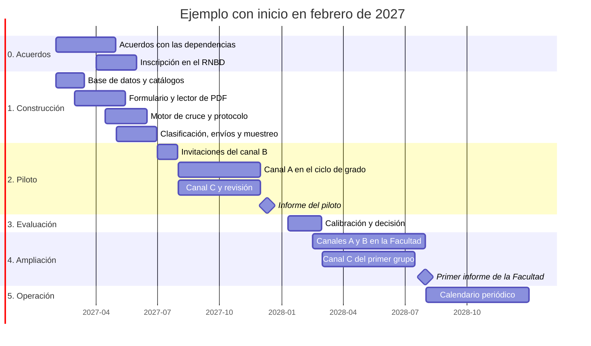

# Plan de implementación

> **Estado:** borrador para revisión. Desarrolla la sección 7 de [`01_metodologia.md`](01_metodologia.md): actividades, recursos, responsables y mecanismos de actualización periódica, como pide el enunciado (punto 3.1).
> Los plazos van en meses relativos al inicio del proyecto (mes 1, mes 2…), y la sección 1.3 muestra un ejemplo con inicio en febrero de 2027. "Mes" se escribe completo para no confundirlo con los momentos de seguimiento (M1, M3, M5…).

## Resumen

- **Seis fases:** acuerdos, construcción, piloto, evaluación, ampliación y operación periódica. La operación completa empieza en el mes 19.
- **Piloto de un semestre con Ingeniería de Sistemas y Computación y sus posgrados** (maestría y doctorado). Sirve para calibrar el puntaje y medir los tiempos reales antes de ampliar.
- **El canal C se dimensiona con las horas del auxiliar** (12 por semana), porque es la única parte que exige trabajo humano por cada egresado. El piloto cabe en un semestre: 476 búsquedas de 576 posibles. Para la Facultad completa no alcanzan las horas de un auxiliar, así que el canal C rota tres programas por año, mientras los canales A y B cubren a todos cada año.
- **La actualización periódica es un calendario de procesos automáticos** (envíos semanales, depuración mensual, calibración trimestral y muestra anual), con indicadores que muestran si el proceso funciona.

## 0. Supuestos

Para planear hacen falta algunos números. Cada uno dice de dónde sale y con qué se reemplaza.

| Supuesto | Valor | De dónde sale | Se reemplaza con |
|---|---|---|---|
| Dedicación del auxiliar | 12 horas por semana | Acordado para este plan | La vinculación real |
| Semanas de trabajo | 16 por semestre, 32 por año | Duración de un periodo académico | El calendario académico |
| Graduados de pregrado de Sistemas | Unos 90 por año | 552 graduados entre 2014 y 2019, según el informe de evaluación continua del programa (ver Fuentes) | El conteo del SIA en la carga oficial (actividad 1.3) |
| Graduados de posgrado de Sistemas | 40 de maestría y 5 de doctorado por año | Supuesto | El conteo del SIA |
| Tiempo por egresado buscado en el canal C | 10 minutos en promedio | Supuesto: unos 12 si se encuentra y hay que registrar su experiencia, unos 5 si no se encuentra | Lo medido en el piloto |
| Tasa de encontrados en el canal C | 60 % | Supuesto conservador | Lo medido en el piloto, por momento y luego por programa |
| Respuesta a las invitaciones del canal B | 20 % | Supuesto | Lo medido en el piloto |
| Participación en el canal A | 60 % de los graduandos | Supuesto | Lo medido en el piloto |

- *Por qué supuestos conservadores:* si el piloto encuentra más perfiles o busca más rápido, sobra capacidad. Si se planeara con valores optimistas, faltaría.

## 1. Fases y cronograma

### 1.1 Las fases

| Fase | Meses | Para qué | Termina cuando |
|---|---|---|---|
| **0. Acuerdos** | 1 a 3 | Conseguir las aprobaciones y los accesos que el resto necesita | La Oficina Jurídica validó los textos, la Secretaría de Facultad entregó el registro oficial y el servidor está listo |
| **1. Construcción** | 1 a 5 | Construir los componentes de prioridad 1 (sección 9) | Todos pasan sus pruebas con datos ficticios y con PDF de voluntarios |
| **2. Piloto** | 6 a 11 | Operar los tres canales con Ingeniería de Sistemas y Computación y sus posgrados | Se buscó toda la muestra y se entregó el informe del piloto |
| **3. Evaluación** | 12 y 13 | Calibrar con lo medido y decidir si se amplía | La coordinación aprueba la ampliación con los parámetros nuevos |
| **4. Ampliación** | 13 a 18 | Incorporar todos los programas de la Facultad, cada uno con sus posgrados | Se publica el primer informe de la Facultad |
| **5. Operación** | Desde el 19 | Seguir el calendario periódico (sección 6) | No termina: se revisa cada año |

- **La construcción empieza sin esperar los acuerdos.** Con datos ficticios, como los de este repositorio, no hace falta ninguna aprobación. Los acuerdos solo se necesitan para cargar datos reales.
- **Ruta crítica:** el acceso al registro oficial y la validación de los textos de autorización. Si no llegan antes del mes 5, el piloto se corre un semestre; la construcción no se detiene.

### 1.2 Cronograma

Ejemplo con inicio en febrero de 2027. Cada barra agrupa actividades de la sección 2.

### 1.3 Ejemplo con inicio en febrero de 2027

| Meses | Ejemplo | Qué pasa |
|---|---|---|
| 1 a 5 | Febrero a junio de 2027 (semestre 2027-1) | Acuerdos y construcción |
| 6 | Julio de 2027 (intersemestral) | Salen las invitaciones del canal B, y su plazo cierra antes del semestre |
| 7 a 10 | Agosto a noviembre de 2027 (semestre 2027-2) | Piloto: canal A en el ciclo de grado, canal C y revisión |
| 11 | Diciembre de 2027 | Informe del piloto |
| 12 y 13 | Enero y febrero de 2028 | Evaluación y decisión de ampliar |
| 13 a 18 | Febrero a julio de 2028 (semestre 2028-1) | Ampliación a la Facultad y primer informe |
| 19 en adelante | Desde agosto de 2028 | Operación periódica |

Las fechas de los semestres son aproximadas y se ajustan al calendario académico.

- *Por qué el piloto ocupa un semestre completo:* el auxiliar se vincula por periodos académicos, y en 16 semanas cabe la muestra completa del canal C (sección 5.4).
- *Por qué las invitaciones salen en el intersemestral:* el bot las envía solo, y así su plazo de cuatro semanas cierra cuando empieza el semestre. Las 16 semanas quedan para buscar y revisar.

## 2. Actividades

Cada actividad tiene un responsable, un resultado y un criterio de terminado que se puede verificar. Los responsables se describen en la sección 3, y las consultas citadas están en [`sql/11_consultas_calidad.sql`](../sql/11_consultas_calidad.sql) (calidad) y [`sql/12_consultas_analisis.sql`](../sql/12_consultas_analisis.sql) (análisis).

### 2.1 Fase 0. Acuerdos (meses 1 a 3)

| # | Actividad | Responsable | Resultado | Terminada cuando |
|---|---|---|---|---|
| 0.1 | Aprobar el plan, el piloto y su alcance, y el umbral de celda mínima para publicar (metodología, sección 6) | Coordinación | Plan y umbral aprobados | Hay una comunicación de aprobación |
| 0.2 | Validar el texto de autorización y el aviso de privacidad de los canales A y B y del formulario directo | Oficina Jurídica | Texto 1.0.0 | El texto está cargado en `texto_autorizacion` con su vigencia |
| 0.3 | Validar la base legal del canal C: dato público (metodología, sección 5) | Oficina Jurídica | Concepto escrito | Hay concepto. Si es negativo, el canal C no opera y el plan sigue con A y B (riesgo 2) |
| 0.4 | Entregar el registro oficial de Sistemas y sus posgrados (grados, documentos y correos) y el calendario de grados | Secretaría de Facultad | Archivo de extracción | El archivo llegó por un canal seguro, no como adjunto de correo |
| 0.5 | Incluir el paso del canal A en la inscripción a grado: autorización, URL y PDF del perfil | Secretaría de Facultad | Paso habilitado para el ciclo de grado del piloto | El paso es visible y opcional: el grado no depende de autorizar, para que el consentimiento sea libre (Ley 1581, art. 4 lit. c) |
| 0.6 | Preparar el servidor, el correo de envío, los respaldos y la custodia de la clave HMAC | Administración de la base | Servidor listo | La instalación de prueba (`instalar_todo.sql`) corre sin errores y un respaldo se restaura completo |
| 0.7 | Definir las ocupaciones afines de Sistemas y de sus posgrados | Comité asesor del programa | Lista de códigos CUOC | La lista está cargada en `afinidad_programa_ocupacion` |
| 0.8 | Acordar con el Programa de Egresados de la sede los datos de contacto y el calendario de envíos | Coordinación | Calendario común | Las solicitudes no coinciden en el mismo mes con otras encuestas a egresados |
| 0.9 | Designar a quien atiende las solicitudes de los titulares | Coordinación | Persona con `rol_titulares` | Conoce el procedimiento de supresión y lo probó en el entorno de pruebas |
| 0.10 | Inscribir la base en el Registro Nacional de Bases de Datos de la SIC dentro de los dos meses siguientes a la carga de datos reales (Decreto 1074 de 2015, art. 2.2.2.26.3.1, modificado por el Decreto 090 de 2018) | Oficina Jurídica | Constancia de inscripción | Hay constancia |

### 2.2 Fase 1. Construcción (meses 1 a 5)

Los componentes y sus horas están en la sección 9.

| # | Actividad | Responsable | Resultado | Terminada cuando |
|---|---|---|---|---|
| 1.1 | Instalar en producción la estructura (scripts 01 a 08) y los catálogos propios del sistema que trae `09_catalogos.sql` (fuentes, momentos, tipos de incidencia, niveles y áreas), sin sus catálogos de ejemplo ni los datos de prueba; crear un usuario por persona y por bot | Administración de la base, con el auxiliar | Base en producción | Producción tiene la misma estructura que el entorno de pruebas, donde `13_pruebas_reglas.sql` da los 18 resultados esperados |
| 1.2 | Cargar los catálogos completos: CUOC (actualización 2025), CIIU Rev. 4 A.C., DIVIPOLA, ISO 3166-1 y los programas de la Facultad con sus códigos SNIES y duraciones | Auxiliar | Catálogos oficiales | Los conteos por nivel coinciden con los archivos oficiales |
| 1.3 | Construir el bot de carga y cargar el registro oficial | Auxiliar | Grados de Sistemas y sus posgrados en la base | Los conteos coinciden con la extracción y se revisaron los posibles duplicados (consulta de calidad 4) |
| 1.4 | Construir el formulario de los canales A y B y el enlace de un clic | Auxiliar | Formulario en el servidor de la Facultad | Una prueba de punta a punta con datos ficticios termina en una captura |
| 1.5 | Construir el lector de PDF y el bot 1 | Auxiliar | Bot 1 | Lee sin incidencias al menos el 90 % de un lote de PDF de voluntarios que autorizan su uso: varios cargos en una empresa, español e inglés, una y varias páginas. Los PDF se borran al terminar |
| 1.6 | Construir el motor de cruce, el bot 2 y el formulario del canal C | Auxiliar | Bot 2 | Reproduce los puntajes y niveles de los datos de prueba |
| 1.7 | Escribir el protocolo de búsqueda 1.0.0 (sección 2.7) | Auxiliar; aprueba la coordinación | Protocolo | Está aprobado y probado con perfiles de voluntarios |
| 1.8 | Construir el bot de clasificación: diccionario primero, IA local después | Auxiliar | Bot de clasificación | Clasifica los textos de los datos de prueba y guarda el modelo y su huella en la ejecución |
| 1.9 | Construir los bots de envíos, muestreo y depuración | Auxiliar | Tres bots | Con datos ficticios: salen los lotes y el recordatorio, la misma semilla da la misma muestra y la depuración deja vacía la consulta de calidad 12 |
| 1.10 | Programar los respaldos y probar una restauración | Administración de la base | Respaldos diarios | Una restauración completa funciona en un servidor de prueba |

### 2.3 Fase 2. Piloto (meses 6 a 11)

| # | Actividad | Responsable | Resultado | Terminada cuando |
|---|---|---|---|---|
| 2.1 | Enviar las invitaciones del canal B a las cohortes de Sistemas y sus posgrados que cumplen M1, M3, M5 o M10 en el año del piloto (en el ejemplo, graduados en 2026, 2024, 2022 y 2017) | Bot de envíos; supervisa el auxiliar | Unas 540 invitaciones | Cerró el plazo de cuatro semanas |
| 2.2 | Operar el canal A en el ciclo de grado del semestre | Secretaría de Facultad y bot 1 | Capturas M0 | Cerró el ciclo de grado |
| 2.3 | Tomar la muestra del canal C entre quienes no respondieron (sección 5.4) | Bot de muestreo; aprueba la coordinación | Muestra con semilla, estratos y pesos | Está registrada en `muestra` y `muestra_egresado` |
| 2.4 | Buscar con el protocolo a los egresados de la muestra | Auxiliar | Búsquedas registradas, también las que no encuentran a nadie | Se buscó toda la muestra |
| 2.5 | Atender la cola de revisión: coincidencias de nivel medio, incidencias y todas las clasificaciones de la IA | Auxiliar | Decisiones registradas | Ningún caso lleva más de 15 días pendiente |
| 2.6 | Auditar todas las aceptaciones automáticas de nivel alto | Coordinación | Decisiones de auditoría | Todas están auditadas |
| 2.7 | Correr la depuración cada mes | Bot de depuración | Conservación limitada al día | La consulta de calidad 12 queda vacía después de cada corrida |
| 2.8 | Escribir el informe del piloto: parámetros medidos (sección 0), indicadores del proceso (sección 7) e indicadores de Sistemas con su cobertura y su margen | Auxiliar y analista | Informe | Se entregó a la coordinación y al comité asesor |

- *Por qué en el piloto se revisa y se audita todo, y no una muestra:* esos casos etiquetados son los que permiten fijar los umbrales del puntaje y el de confianza de la IA. Después del piloto, la auditoría pasa a una muestra mensual (sección 6).
- *Por qué audita la coordinación y no el auxiliar:* quien buscó un perfil no es independiente para auditar su propia búsqueda.

### 2.4 Fase 3. Evaluación (meses 12 y 13)

| # | Actividad | Responsable | Resultado | Terminada cuando |
|---|---|---|---|---|
| 3.1 | Comparar el piloto con los criterios de salida (tabla siguiente) | Coordinación | Decisión: ampliar, ampliar con ajustes o repetir una parte | Hay acta |
| 3.2 | Recalibrar pesos y umbrales con las auditorías | Auxiliar; aprueba la coordinación | Parámetros versión 1.1.0 | Quedan registrados en las ejecuciones de los bots |
| 3.3 | Ajustar el protocolo, el lector y el formulario con lo aprendido | Auxiliar | Versiones nuevas en el repositorio | Pasan las pruebas de la fase 1 |
| 3.4 | Recalcular el tamaño de la muestra con los parámetros medidos y fijar la rotación del canal C (sección 5.5) | Auxiliar; aprueba la coordinación | Plan de rotación | Está aprobado |

**Criterios de salida del piloto**

| Criterio | Meta | Si no se cumple |
|---|---|---|
| Precisión del nivel alto en la auditoría | ≥ 95 %, con al menos 50 casos auditados | Se sube el umbral alto y se audita otra vez antes de ampliar |
| PDF leídos sin incidencia de lectura | ≥ 90 % | Se corrige el lector antes de ampliar |
| Supresiones atendidas en el plazo legal | 100 % | No se amplía hasta corregir el procedimiento |
| Depuración al día | Ningún PDF ni dato observado pendiente después de cada corrida | No se amplía hasta corregirla |
| Parámetros medidos | Minutos por búsqueda, tasa de encontrados, respuesta del canal B y participación del canal A | Se amplía igual, pero la sección 5 se recalcula con lo medido |
| Utilidad | El comité asesor revisó los indicadores de Sistemas | Se ajustan las preguntas de análisis antes de ampliar |

- *Por qué unos criterios bloquean la ampliación y otros no:* los cuatro primeros protegen a las personas (identificarlas mal, conservar datos de más o no atender una supresión). Los parámetros solo cambian cuánto se puede hacer.

### 2.5 Fase 4. Ampliación (meses 13 a 18)

| # | Actividad | Responsable | Resultado | Terminada cuando |
|---|---|---|---|---|
| 4.1 | Cargar el registro oficial de toda la Facultad, pregrado y posgrado | Bot de carga | Todos los grados en la base | Los conteos coinciden con la extracción |
| 4.2 | Definir las ocupaciones afines de cada programa | Comités asesores | Listas de códigos CUOC | Están cargadas |
| 4.3 | Abrir el canal A en todos los programas desde el siguiente ciclo de grado | Secretaría de Facultad | Capturas M0 de toda la Facultad | El paso está en la inscripción a grado de todos los programas |
| 4.4 | Activar los envíos semanales del canal B para todos los programas | Bot de envíos | Solicitudes en el aniversario del grado | El bot corre cada semana sin fallas |
| 4.5 | Hacer el canal C del primer grupo de la rotación: tres programas | Auxiliar | Búsquedas y capturas | Se buscó la muestra del grupo |
| 4.6 | Publicar el primer informe de la Facultad con las reglas de publicación (metodología, sección 6) | Analista | Informe | Lo aprobó la Vicedecanatura Académica |

### 2.6 Fase 5. Operación (desde el mes 19)

Se sigue el calendario de la sección 6. Cada año la coordinación revisa el plan: horas, márgenes, momentos de seguimiento y rotación.

### 2.7 Protocolo de búsqueda del canal C (borrador de la versión 1.0.0)

Cada búsqueda guarda la versión del protocolo con que se hizo (`busqueda.version_protocolo`), así que un cambio de protocolo se puede rastrear.

1. Abrir el caso desde el formulario del canal C. Antes, el bot 2 comprueba que el egresado no esté en la lista de no contactar.
2. Buscar en LinkedIn con la cuenta propia del auxiliar, por nombre y primer apellido, con la Universidad Nacional de Colombia como institución educativa. Si hay muchos resultados, agregar el segundo apellido.
3. Revisar como máximo los cinco primeros candidatos que mencionen la Universidad.
4. De cada candidato posible, registrar solo lo que pide el formulario: nombre visible, estudios con años, ciudad y URL. Nada más: ni foto, ni contactos, ni capturas de pantalla.
5. Si nadie coincide, registrar la búsqueda como "no encontrado". Si hay varios posibles, registrarlos todos ("varios candidatos") y dejar que el bot 2 los puntúe.
6. Dedicar como máximo 15 minutos a cada egresado.
7. Si el bot 2 o la revisión aceptan un candidato, registrar su experiencia y sus estudios en la captura del canal C, con los mismos campos que se extraen del PDF.
8. Nunca escribir, invitar ni seguir al egresado desde LinkedIn. La invitación a autorizar va por correo, desde la Universidad.

## 3. Responsables

| Responsable | Quién (propuesta) | Rol en MariaDB | Responde por |
|---|---|---|---|
| Coordinación | Vicedecanatura Académica (UAPA) | `rol_revisor`, para auditar | Aprobar el plan y los cambios de parámetros, gestionar los acuerdos, auditar en el piloto y decidir la ampliación |
| Estudiante auxiliar | Auxiliar de automatización, 12 horas por semana | `rol_revisor` | Construir y mantener los bots, buscar en el canal C, atender la cola de revisión y entregar un informe semanal |
| Administración de la base | Área de tecnología de la Facultad | `rol_admin` | Servidor, cuentas, respaldos, actualizaciones de MariaDB y custodia de la clave HMAC |
| Atención a los titulares | Persona designada por la Facultad | `rol_titulares` | Revocatorias y supresiones dentro del plazo legal |
| Analista | Profesional de la Vicedecanatura Académica | `rol_analista` | Calcular y publicar los indicadores con las reglas de publicación |
| Bots | Una cuenta de servicio por bot | `rol_bot` | Carga, consolidación, verificación, clasificación, envíos, muestreo y depuración |
| Oficina Jurídica | Universidad | Ninguno | Textos de autorización, base legal del canal C e inscripción en el RNBD |
| Secretaría de Facultad | Facultad | Ninguno | Registro oficial, calendario de grados y paso del canal A en la inscripción a grado |
| Comité asesor de cada programa | Programa curricular | Ninguno | Ocupaciones afines y revisión de los indicadores de su programa |
| Programa de Egresados | Sede Bogotá | Ninguno | Datos de contacto y coordinación de los envíos con sus encuestas |

- **El auxiliar no tiene `rol_admin` en producción.** Los cambios de estructura se preparan en el repositorio, se prueban en el entorno de pruebas y los aplica la administración de la base. *Por qué:* mínimo privilegio, y queda registro de qué cambió y quién lo aprobó.
- **Un usuario por persona y por bot** ([`02_modelo_datos.md`](02_modelo_datos.md), paso 0.4): así la bitácora registra quién hizo cada cambio.
- **Si cambia el auxiliar,** a la persona nueva se le asigna `rol_revisor` y a la anterior se le retira. El conocimiento queda en el repositorio, en el protocolo y en los diccionarios de la base (riesgo 5).

## 4. Recursos

### 4.1 Personas

| Persona | Dedicación | En qué |
|---|---|---|
| Estudiante auxiliar | 12 horas por semana | Fase 1: construcción. Desde la fase 2: canal C, revisión y mantenimiento (sección 5.1) |
| Coordinación | Unas 2 horas por semana | Acuerdos y aprobaciones; en el piloto, además, la auditoría (unas 7 horas en el semestre) |
| Administración de la base | Unas 2 horas por mes | Respaldos, cuentas y actualizaciones |
| Atención a los titulares | Según las solicitudes | Supresiones |
| Analista | Unos días por informe | Indicadores semestrales y anuales |
| Comités asesores | Una sesión por programa | Ocupaciones afines y revisión de indicadores |

### 4.2 Tecnología

| Recurso | Para qué | Por qué este y no otro |
|---|---|---|
| Servidor virtual de la Facultad (orientativo: 4 núcleos, 16 GB de RAM y 100 GB de disco) | MariaDB, bots, IA local y PDF temporales | Los datos personales no salen de la Universidad (metodología, decisión 10). Con 16 GB cabe un modelo de lenguaje pequeño; sin tarjeta gráfica es lento, pero solo clasifica los textos que el diccionario no conoce |
| MariaDB 12.3 LTS | Las dos bases | Metodología, decisiones 19 y 20 |
| Python 3 y bibliotecas libres | Los bots | Tiene bibliotecas maduras para cada tarea: leer PDF con la posición de cada texto (necesario por las dos columnas), comparar nombres, conectarse a MariaDB y llamar a la IA local. Es común en la formación de ingeniería, lo que facilita el relevo de auxiliares |
| Ollama con un modelo abierto | Clasificación | IA local (decisión 10). Cada ejecución guarda el modelo y su huella, así que una clasificación se puede reproducir |
| Programador de tareas del servidor | Correr los bots según el calendario | Viene con el sistema operativo; no hace falta otra herramienta |
| Correo institucional | Invitaciones y solicitudes del canal B | El egresado reconoce el remitente de la Universidad. Un servicio externo de envíos recibiría los correos de los egresados y sería otro encargado del tratamiento |
| Repositorio Git | Código, SQL, protocolo y parámetros | Guarda el historial de cada cambio y permite revisarlo antes de aplicarlo. Nunca guarda datos personales |
| Cuenta de LinkedIn del auxiliar | Búsquedas del canal C | Las búsquedas son manuales, y LinkedIn solo admite cuentas de personas reales: una cuenta genérica de la Facultad violaría sus condiciones |

**Costo:** todo el software es libre o institucional, así que no hay licencias que pagar. El costo principal son las horas del auxiliar.

## 5. Capacidad del auxiliar y tamaño de la muestra

Este cálculo dice si el plan es viable. Los canales A y B son automáticos; el canal C exige horas humanas por cada egresado, así que es el que se dimensiona.

### 5.1 Las horas del auxiliar

Horas por semana:

| Fase | Construir o ajustar | Canal C | Revisión | Coordinación y mantenimiento |
|---|---|---|---|---|
| 0 y 1 (meses 1 a 5) | 11 | — | — | 1 |
| 2. Piloto | — | 6 | 4 | 2 |
| 3. Evaluación | 8 | — | 4 | — |
| 4 y 5. Ampliación y operación | — | 6 | 4 | 2 |

- **Construcción: unas 176 horas** (11 por semana durante 16 semanas), y los componentes de prioridad 1 suman unas 173 (sección 9). El margen es poco: si la construcción se atrasa, la IA de clasificación pasa a prioridad 2, y en el piloto se clasifica con el diccionario y a mano.
- **Revisión en el piloto: unas 63 horas en el semestre, unas 4 por semana.** Son unos 40 PDF del canal A y 108 respuestas del canal B, a 10 minutos cada uno, y unos 286 perfiles encontrados en el canal C, a 8 minutos (revisar la coincidencia y la clasificación).
- **Si la semana no alcanza, este es el orden:** primero las supresiones, que tienen plazo legal; después la revisión, porque un dato sin verificar no se puede usar; al final el canal C.

### 5.2 Cuántas búsquedas caben

Con 6 horas semanales para el canal C y 10 minutos por egresado:

- **Por semestre:** 6 horas × 16 semanas = 96 horas = **576 búsquedas**.
- **Por año:** 192 horas = **1.152 búsquedas**.

### 5.3 Tamaño de la muestra por estrato

Se parte de la fórmula de la metodología (sección 1.6), con z = 1,96 (95 % de confianza) y p = 0,5, que es el caso más exigente:

- **n0 = 96** para un margen de ±10 %, y **43** para ±15 %.
- **La población del estrato (N) son quienes no respondieron a la invitación del canal B.** Quienes respondieron ya están medidos y pesan 1; la muestra representa al resto. Es el submuestreo de no respondientes de Hansen y Hurwitz (1946): una primera fase barata (el correo) y, para quienes no responden, una muestra con un método más costoso (la búsqueda manual). Para planear se usa N = toda la cohorte, que es una cota superior.
- **Ajuste por los no encontrados:** el número de búsquedas es n dividido por la tasa de encontrados (0,6), con un máximo de N.
- **Censo en estratos pequeños:** si las búsquedas llegan a N, se busca a todos.

| Egresados en el estrato (N) | ±10 %: perfiles necesarios / búsquedas | ±15 %: perfiles necesarios / búsquedas |
|---|---|---|
| 5 | 5 / 5 (censo) | 5 / 5 (censo) |
| 30 | 24 / 30 (censo) | 18 / 30 (censo) |
| 40 | 29 / 40 (censo) | 21 / 35 |
| 90 | 47 / 79 | 30 / 50 |
| 300 | 73 / 122 | 38 / 64 |

Con 30 egresados o menos, la muestra es todo el estrato: muestrear no ahorra nada.

### 5.4 El piloto cabe en un semestre

Los estratos son las cohortes que cumplen M1, M3, M5 o M10 en el año del piloto, separadas por nivel. Cada persona entra en un solo estrato, el de su último grado (la llave de `muestra_egresado` no admite dos veces a la misma persona en una muestra).

| Nivel | Egresados por cohorte | Margen | Búsquedas por momento | Cuatro momentos |
|---|---|---|---|---|
| Pregrado | 90 | ±10 % | 79 | 316 |
| Maestría | 40 | ±15 % | 35 | 140 |
| Doctorado | 5 | Censo | 5 | 20 |
| **Total** | | | | **476 de 576 (83 %)** |

- *Por qué ±10 % en pregrado y ±15 % en posgrado:* con la misma capacidad se da más precisión al grupo más grande, que es el de la mayoría de los indicadores.
- *Por qué esos cuatro momentos:* M1 mide la vinculación al año y la inserción; M5 y M10, la evolución de la trayectoria (metodología, sección 6, preguntas 1, 3 y 7). M3 muestra el paso entre ellos.
- El 17 % que sobra cubre las diferencias con los supuestos. Si el SIA muestra cohortes más grandes, se aplica la regla de la sección 5.6.

### 5.5 La Facultad completa: el canal C rota

Con el diseño del piloto, nueve programas como Sistemas necesitarían unas 4.300 búsquedas al año: casi cuatro veces lo que da un auxiliar. Por eso la ampliación cambia dos cosas:

1. **Margen de ±15 % en todos los estratos.** Así, un programa del tamaño de Sistemas, con su maestría y su doctorado, necesita unas 360 búsquedas al año.
2. **Rotación:** en 1.152 búsquedas al año caben **tres programas por año**, así que cada programa pasa por el canal C cada tres años. Se empieza por los programas con la autoevaluación más cercana, que es cuando más se necesitan sus indicadores.

- **Los canales A y B no rotan.** Son automáticos y cubren a todos los programas cada año.
- **El margen por estrato es amplio, pero baja al agregar.** Con ±15 % por programa y momento, el margen queda cerca de ±7 % para un programa (sus cuatro momentos juntos) y cerca de ±5 % para un momento en toda la Facultad (los nueve programas, al completar la rotación).
- **Si la Facultad quiere todos los programas cada año,** el canal C necesita unas 3.240 búsquedas, unas 540 horas: casi tres auxiliares como el de este plan.
- **El canal C es un puente.** Cada año entra una cohorte nueva por el canal A, y la población del canal C se reduce a quienes no autorizan ni responden.

### 5.6 Regla anual

Cada año, antes de tomar la muestra, el bot de muestreo y la coordinación:

1. Calculan la capacidad: horas para el canal C × 60 ÷ minutos medidos por búsqueda.
2. Calculan las búsquedas de cada estrato con la población real (quienes no respondieron), el margen y la tasa de encontrados medida en ese programa.
3. Si caben, se hace la muestra. Si no, en este orden: (a) margen de ±15 % donde era de ±10 %; (b) menos programas en el año, es decir, una rotación más larga; (c) pedir más horas.
4. Guardan el diseño en la base: margen, confianza y semilla en `muestra`; estrato y peso en `muestra_egresado`; tasa de encontrados y minutos usados en los parámetros de la ejecución.
5. Al cerrar el año, calculan el margen que de verdad se logró con los perfiles encontrados. Ese es el que se publica con cada indicador.

## 6. Mecanismo de actualización periódica

| Proceso | Frecuencia | Cuándo y cómo | Quién | Queda en |
|---|---|---|---|---|
| Carga del registro oficial | Cada ciclo de grado | Al cerrar las inscripciones (grado en trámite) y después de la ceremonia (grado otorgado) | Bot de carga | `grado`, `ejecucion` |
| Canal A | Cada ciclo de grado | Durante la inscripción a grado | Graduando y bot 1 | `autorizacion`, `captura` |
| Canal B | Semanal | Cada lunes, a quienes cumplen un momento esa semana, con un tope semanal. Un solo recordatorio a los 14 días; el enlace vence a los 30 | Bot de envíos | `solicitud_actualizacion` |
| Clasificación | Diaria | Cada noche, sobre las capturas nuevas | Bot de clasificación | Clasificaciones de `experiencia` y `estudio_declarado` |
| Revisión | Semanal | Cola de coincidencias, incidencias y clasificaciones | Auxiliar | `decision_coincidencia`, `incidencia` |
| Canal C | Anual, por rotación | Al empezar el año, muestra entre quienes cumplieron un momento el año anterior y no respondieron, en los programas que tocan ese año. Las búsquedas se reparten en los dos semestres | Bot de muestreo y auxiliar | `muestra`, `busqueda` |
| Auditoría del nivel alto | Mensual | El 10 % de las aceptaciones automáticas del mes, con un mínimo de 10 | Coordinación | `decision_coincidencia` |
| Depuración | Mensual | Primer día hábil del mes | Bot de depuración | `ejecucion` |
| Calibración | Trimestral | Se revisan la precisión del nivel alto y la de la IA; los parámetros cambian solo si bajan de la meta | Auxiliar; aprueba la coordinación | Parámetros de la ejecución |
| Respaldos | Diaria | Prueba de restauración cada trimestre | Administración de la base | Fuera de la base, cifrados en el caso de la identidad |
| Catálogos del DANE | Cuando el DANE publique una actualización | Se revisa una vez al año | Auxiliar | `ejecucion` (carga de catálogos) |
| Indicadores | Semestral y anual | Semestral para la Vicedecanatura; anual para la Facultad | Analista | Informes |
| Supresiones | Según las solicitudes | Máximo 15 días hábiles, prorrogables 8 (Ley 1581, art. 15) | Atención a los titulares | `solicitud_supresion` |
| Revisión del plan | Anual | Horas, márgenes, momentos y rotación | Coordinación | Este documento |

- *Por qué envíos semanales en el aniversario del grado, y no un envío anual:* la solicitud llega en el momento que mide, y la revisión se reparte en el año. Como las ceremonias concentran los grados, el tope semanal reparte una cohorte grande en varias semanas.
- *Por qué un solo recordatorio:* cada mensaje de más suma cansancio, que es justo lo que los momentos de seguimiento buscan evitar.
- *Por qué el enlace vence a los 30 días:* da tiempo para responder, y un enlace que se filtre deja de servir pronto.
- *Por qué calibrar cada trimestre y no con cada caso:* un trimestre acumula suficientes auditorías, y cambiar los parámetros muy seguido haría incomparables los resultados de un mes a otro.
- **Si una persona tiene varios grados,** los momentos se cuentan desde el último, como en la consulta de calidad 5. Cada momento se pide una sola vez por persona (lo garantiza la llave única de `solicitud_actualizacion`): si ya se pidió con un grado anterior, se omite, porque la captura del grado nuevo (M0) ya actualizó el perfil.

## 7. Indicadores del proceso

Miden si el proceso funciona, no la situación de los egresados (esa está en la sección 6 de la metodología). Las metas son iniciales y se ajustan en la fase 3. Las consultas marcadas como nuevas son de prioridad 2 (sección 9).

| Grupo | Indicador | Cómo se calcula | Meta inicial | Dónde |
|---|---|---|---|---|
| Participación | Participación en el canal A | Graduandos que autorizan o llenan el formulario directo ÷ graduandos del ciclo | ≥ 60 % | `autorizacion` y `grado` (consulta nueva) |
| Participación | Respuesta por momento | Solicitudes respondidas ÷ solicitudes entregadas, por momento | ≥ 25 % si ya tenía captura; ≥ 10 % en invitaciones a cohortes antiguas | Consulta de calidad 10 |
| Participación | Rebote | Solicitudes rebotadas ÷ solicitudes enviadas | ≤ 10 % | `solicitud_actualizacion` (consulta nueva) |
| Cobertura | Egresados con captura vigente | Egresados con captura verificada ÷ egresados con grado otorgado | Crece cada semestre | Consulta de análisis 1 |
| Cobertura | Encontrados en el canal C | Búsquedas con resultado "encontrado" ÷ búsquedas, por estrato | Se mide y se publica con cada indicador | Consulta de calidad 11 |
| Cobertura | Desactualizados | Egresados con un momento vencido sin verificación posterior ÷ egresados | Baja cada año | Consulta de calidad 5 |
| Calidad | Precisión del nivel alto | Aceptaciones automáticas que la auditoría confirma ÷ aceptaciones auditadas | ≥ 95 % | Consulta de calidad 8 |
| Calidad | Precisión de la IA | Propuestas de la IA que la revisión no cambia ÷ propuestas revisadas | ≥ 80 % | Consulta de calidad 9 |
| Calidad | Resuelto por el diccionario | Clasificaciones hechas con el diccionario ÷ clasificaciones | Crece cada trimestre | `experiencia` (consulta nueva) |
| Calidad | Lectura de PDF | PDF sin incidencia de lectura ÷ PDF recibidos | ≥ 90 % | `incidencia` (consulta nueva) |
| Operación | Cola de revisión | Casos pendientes con más de 15 días | 0 | Consultas de calidad 1 y 2 |
| Operación | Minutos por búsqueda | Horas del canal C según el informe semanal × 60 ÷ búsquedas registradas | ≤ 10 | `busqueda` e informe semanal |
| Operación | Ejecuciones fallidas | Ejecuciones con resultado "fallida" sin atender después de 2 días hábiles | 0 | `ejecucion` (consulta nueva) |
| Cumplimiento | Supresiones en plazo | Supresiones atendidas en el plazo legal ÷ solicitudes recibidas | 100 % | `solicitud_supresion` (consulta nueva) |
| Cumplimiento | Conservación limitada | PDF y datos observados pendientes de borrar después de la depuración | 0 | Consulta de calidad 12 |

## 8. Riesgos

| # | Riesgo | Cómo se detecta | Qué se hace | Responsable |
|---|---|---|---|---|
| 1 | El acceso al registro oficial se demora | La actividad 0.4 no termina en el mes 3 | Se pide en la primera semana. La construcción sigue con datos ficticios, y si el acceso no llega antes del mes 5, el piloto se corre un semestre | Coordinación |
| 2 | La Oficina Jurídica no valida la base legal del canal C | Concepto negativo en la actividad 0.3 | Los canales A y B no dependen de él. Las cohortes antiguas se cubren solo con invitaciones, y los indicadores se publican con su menor cobertura y se contrastan con el Observatorio Laboral | Coordinación |
| 3 | Pocos egresados responden | La respuesta por momento queda bajo la meta | Mensaje firmado por el programa, difusión con la asociación de egresados (en Sistemas, AISUN), un clic cuando nada cambió y un solo recordatorio | Coordinación y auxiliar |
| 4 | LinkedIn cambia o retira "Guardar en PDF" | Suben las incidencias de lectura | El lector tiene un lote de PDF de prueba que se corre con cada cambio. Mientras se ajusta, el egresado puede usar el formulario directo | Auxiliar |
| 5 | Cambia el auxiliar | Termina su vinculación | Todo está en el repositorio (código, SQL, protocolo y parámetros), los permisos son por rol y los diccionarios viven en la base. Las dos últimas semanas de cada vinculación se dedican a la entrega | Coordinación |
| 6 | LinkedIn limita las búsquedas de una cuenta gratuita por uso intensivo (su límite de uso comercial, que se renueva cada mes) | Las búsquedas dejan de mostrar resultados | Repartir las búsquedas en el mes (unas 30 por semana en el piloto) y medirlo en el piloto. Si el límite aparece, se alarga el periodo de búsqueda | Auxiliar |
| 7 | Se acepta un perfil que no es del egresado | La precisión del nivel alto queda bajo la meta | Subir el umbral y auditar más. Al rechazar la coincidencia, sus capturas quedan rechazadas (la base ya lo hace) | Coordinación |
| 8 | La IA clasifica mal | La precisión de la IA queda bajo la meta | El diccionario va primero, y se sube el umbral de confianza para que más casos pasen por revisión | Auxiliar |
| 9 | Alguien accede a la identidad sin necesitarlo | Revisión de cuentas y permisos cada semestre | Dos bases, roles mínimos, respaldos de identidad cifrados y guardados aparte, y conservación limitada: menos datos, menos exposición. En prioridad 3, registrar también las lecturas con el complemento de auditoría de MariaDB | Administración de la base |
| 10 | Se pierde o se filtra la clave HMAC | Prueba anual: la copia de la clave reproduce una huella conocida | Dos copias con custodios distintos, nunca en la base ni en el repositorio. Es crítica porque no se puede cambiar: las huellas no se recalculan sin los datos originales, que ya se borraron | Administración de la base |
| 11 | La revisión se satura al ampliar | Casos pendientes con más de 15 días | Tope semanal de envíos, orden de prioridad de las horas (sección 5.1), rotación del canal C y crecimiento del diccionario | Coordinación |
| 12 | Los egresados reciben encuestas de varias dependencias | Quejas o caída de la respuesta | Calendario común con el Programa de Egresados (actividad 0.8) | Coordinación |
| 13 | LinkedIn representa mejor a unos sectores que a otros | Diferencias con el Observatorio Laboral | Formulario directo para quien no tiene LinkedIn, pregunta de situación laboral y cobertura publicada con cada indicador | Analista |

## 9. Componentes de automatización

Prioridad 1: sin esto no hay piloto. Prioridad 2: antes de ampliar. Prioridad 3: mejoras. Las horas son una estimación inicial para planear, y el piloto las corrige.

| Prioridad | Componente | Qué hace | Horas |
|---|---|---|---|
| 1 | Instalación y usuarios | Estructura en el servidor y un usuario por persona y por bot | 8 |
| 1 | Carga de catálogos | CUOC, CIIU, DIVIPOLA, ISO 3166-1 y programas con sus códigos SNIES, desde los archivos oficiales | 12 |
| 1 | Bot de carga | Registro oficial del SIA a `egresado`, `identidad`, `documento_identidad` y `grado` | 12 |
| 1 | Formulario de los canales A y B | Autorización, URL, PDF, "no tengo LinkedIn", situación laboral y enlace de un clic | 30 |
| 1 | Lector de PDF y bot 1 | Comprueba la URL y la huella del archivo, extrae por columnas, revisa la coherencia con el registro oficial, carga la captura y abre incidencias | 40 |
| 1 | Motor de cruce y bot 2 | Puntaje, niveles, casos imposibles, lista de no contactar con HMAC y formulario del canal C | 25 |
| 1 | Bot de clasificación | Diccionario, IA local y cola de revisión | 20 |
| 1 | Bots de envíos, muestreo y depuración | Lotes semanales y recordatorio; estratos, tamaños, semilla y pesos; conservación limitada | 26 |
| | **Total de prioridad 1** | | **173** |
| 2 | Indicadores ponderados | Vista que da a cada egresado su peso: 1 si respondió por los canales A o B; si salió de la muestra del canal C, la población de su estrato dividida entre los encontrados en él | 15 |
| 2 | Consultas nuevas | Las de la sección 7 marcadas como nuevas | 8 |
| 2 | Panel de revisión | Página para atender la cola sin escribir SQL | 25 |
| 2 | Alertas | Correo cuando una ejecución falla o la cola pasa de 15 días | 6 |
| 2 | Carga de indicadores externos | Observatorio Laboral a `indicador_externo` | 8 |
| 3 | Registro de lecturas | Complemento de auditoría de MariaDB sobre `egresados_identidad` | 6 |
| 3 | Cifrado en reposo | Tablas de identidad cifradas con un complemento de gestión de claves | 6 |
| 3 | API de portabilidad de LinkedIn | Para egresados que viven en la UE, el EEE o Suiza (metodología, sección 1.2): evaluar si compensa | Por definir |

- *Por qué los indicadores ponderados son prioridad 2:* en el piloto, con un solo programa, el informe puede aplicar los pesos a mano; con nueve programas hace falta la vista. Las consultas de análisis actuales no ponderan: muestran la estructura con los datos de prueba.

## 10. Registro de decisiones del plan

| # | Se eligió | En vez de | Por qué |
|---|---|---|---|
| 1 | Un piloto con un programa | Arrancar con toda la Facultad | Mide tiempos y tasas, calibra el puntaje y prueba el lector con poco riesgo. Un error de diseño afecta a un programa y no a nueve |
| 2 | Ingeniería de Sistemas y Computación como piloto | Otro programa | Tiene un tamaño medio (unos 90 graduados al año); su propio informe de evaluación continua reconoce «limitaciones para mantener información actualizada» de sus egresados; tiene maestría y doctorado para probar los dos niveles, y una asociación de egresados (AISUN) que puede difundir las invitaciones. Limitación: es probablemente el programa con más uso de LinkedIn, así que la tasa de encontrados se vuelve a medir en cada programa |
| 3 | Posgrados junto con el pregrado, desde el piloto | Una fase posterior para el posgrado | El modelo ya cubre los dos niveles (metodología, decisión 16). Quien tiene los dos grados recibe una sola invitación, y desde el inicio se prueba el paso de pregrado a posgrado (pregunta 6 de análisis). Los posgrados gradúan menos personas, así que el costo adicional es bajo |
| 4 | Meses relativos, con un ejemplo en 2027 | Fechas fijas | La fecha de inicio depende de la vinculación del auxiliar y de las aprobaciones. Los meses relativos siguen valiendo si el inicio se mueve |
| 5 | Submuestreo de no respondientes (Hansen y Hurwitz, 1946) | Muestra sobre toda la cohorte | Quienes respondieron ya están medidos; las horas de búsqueda se gastan solo donde faltan datos |
| 6 | Ajustar el tamaño por la tasa de encontrados | Buscar exactamente n | Si se buscan n y solo se encuentra el 60 %, el margen real queda peor que el planeado |
| 7 | Censo en estratos pequeños | Muestra en todos los estratos | Con 30 personas o menos, la muestra es todo el estrato: buscar a todos elimina el error de muestreo sin costo adicional |
| 8 | En el piloto, ±10 % en pregrado y ±15 % en posgrado | El mismo margen en todo | Con la misma capacidad se da más precisión al grupo más grande |
| 9 | Canal C por rotación de tres programas por año | Todos los programas cada año | Con un auxiliar de 12 horas caben unas 1.150 búsquedas al año, y todos los programas cada año necesitarían unas 3.240. Los canales A y B sí cubren a todos cada año |
| 10 | Revisar y auditar el 100 % en el piloto | Auditar por muestreo desde el inicio | Esos casos son los que permiten fijar los umbrales y medir la precisión de la IA |
| 11 | Audita la coordinación | Audita el mismo auxiliar | Quien buscó un perfil no es independiente para auditarlo |
| 12 | Envíos semanales en el aniversario del grado, con tope | Un envío anual a todos | La solicitud llega en el momento que mide, y la revisión se reparte en el año |
| 13 | El auxiliar sin `rol_admin` en producción | Darle todos los permisos | Mínimo privilegio: los cambios de estructura pasan por el repositorio y los aplica la administración de la base |
| 14 | Orden de las horas: supresiones, revisión y canal C | Repartir las horas de forma fija | Una supresión tiene plazo legal y un dato sin verificar no se puede usar; una búsqueda nueva puede esperar |

## Fuentes

| Dato | Fuente | Estado |
|---|---|---|
| Ingeniería de Sistemas y Computación: 552 graduados entre 2014 y 2019; duración de 10 semestres; comité asesor con representante de los egresados; asociación de egresados AISUN; limitaciones para mantener actualizada la información de los egresados | [Informe de evaluación continua 2019 del programa](https://ingenieria.bogota.unal.edu.co/images/recursos/dependencias/areasCurriculares/areaSistemas/Informe_Evaluacion_Continua_2019_-_Ingenieria_SyC.pdf) (Área Curricular de Ingeniería de Sistemas e Industrial, 2021) | Verificado |
| Submuestreo de no respondientes | Hansen, M. H. y Hurwitz, W. N. (1946). The problem of non-response in sample surveys. *Journal of the American Statistical Association*, 41(236), 517–529 | Verificado |
| Inscripción en el Registro Nacional de Bases de Datos: las entidades públicas están obligadas, y las bases nuevas se inscriben dentro de los dos meses siguientes a su creación | Decreto 1074 de 2015, art. 2.2.2.26.3.1, modificado por el Decreto 090 de 2018 | Verificado en fuentes secundarias (Asuntos Legales, 2018). Confirmar el texto vigente con la Oficina Jurídica |
| Principio de libertad; plazo de 15 días hábiles, prorrogables 8, para atender un reclamo | Ley 1581 de 2012, arts. 4 y 15 | Verificado (ver `01_metodologia.md`) |
